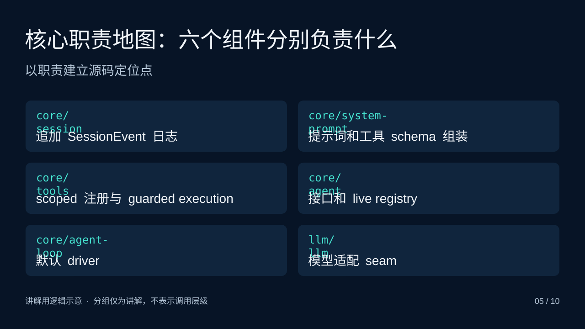
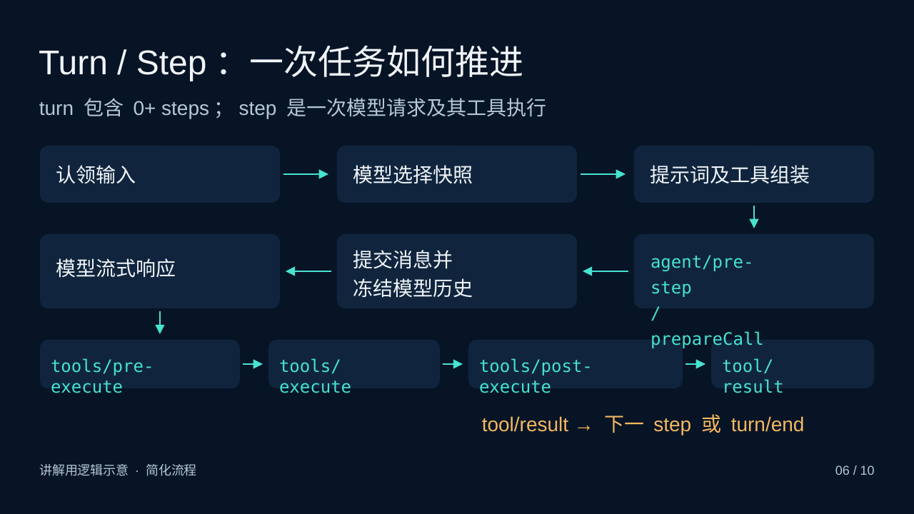
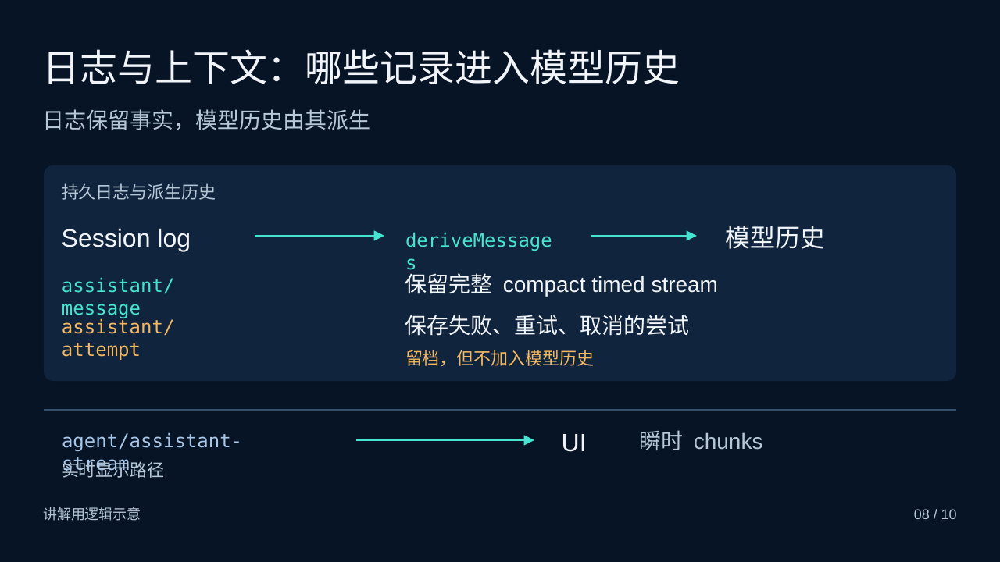

# PPT 服务评价

服务：[ppt-service.panghuer.top](https://ppt-service.panghuer.top/)

跟踪 Issue：[最新产物排版、版本辨识与内容改进 #2](https://github.com/zmhhaha/panghu-service-feedback/issues/2)

最近一次实际体验：**2026年11月3日（北京时间）**。整理日期：2026年11月4日。本页描述最近一次体验发现的开放问题；历史失败和修复进展见 [history.md](history.md)。

## 普通用户结论

**主观评价：6/10。适合作为技术分享初稿，正式演示前需要修排版，并补充通俗解释。**

本次从原项目的正常界面下载《DeepSeek Harness（DSH）架构解析》新版，逐页查看网站标明的“最终PPTX渲染预览”。对象生成于2026年11月2日22:28:12，共10页，原生PPTX文件53,781字节。下载与逐页预览均可用。

本次没有在桌面PowerPoint中实际放映或编辑。外观评价以网站提供的最终PPTX渲染结果为依据；此前对另一份稿件的XML结构检查不代替本次桌面编辑验证。

## 已经做得好的地方

- 深蓝、青色、琥珀色统一，标题层级明确，适合技术主题。
- 内容从插件装配讲到任务执行、会话历史，最后回到四条核心结论，顺序有主线。
- 第3页把共享`dsh-base`的四种运行形态放在一起，并将`sdk-minimal`单列，关系容易理解。
- 第8页明确说明“留档，但不加入模型历史”，有助于理解日志与模型上下文的区别。
- 正常界面能下载文件，并逐页查看最终PPTX渲染效果。相较早期只有源SVG预览的情况，这是已经实测到的改善。

## 当前开放条目

| 编号 | 问题 | 优先级 | 状态与依据 |
|---|---|---|---|
| PPT-UX-001 | 最终PPTX渲染出现断词、文字重叠和出框 | 高 | 开放；2026-11-03实际观察 |
| PPT-UX-002 | 新旧版本标签与下载入口难以辨认 | 中 | 开放；2026-11-03实际观察 |
| PPT-CONTENT-001 | 术语缺少解释，没有贯穿的具体任务 | 中 | 开放；2026-11-03普通用户内容评价 |

### PPT-UX-001：最终PPTX渲染出现断词、重叠和出框

**现象**

| 页码 | 实际观察 |
|---|---|
| 第2页 | `tools`被拆成`tool`与`s`两行；`model adapter`、`session log`等标签也多次换行。标签右侧仍有较多空白。 |
| 第5页 | 六张组件卡片的英文名称换行后，与下方中文职责说明重叠，例如`core/session`、`core/system-prompt`。 |
| 第6页 | `agent/pre-step / prepareCall`变成多行并伸出方框；底部多个工具事件标签超出框的高度。 |
| 第8页 | `deriveMessages`最后一个`s`单独成行；`agent/assistant-stream`与中文“实时显示路径”重叠。 |
| 第9页 | `Consumer`拆成`Consume`与`r`两行，其他标签也存在生硬换行。 |

**对用户的影响**：英文标识难以辨认，图形容器与文字脱离。拿到文件后还需要手动调整字体和文本框，影响现场讲解与直接分享。

**直接证据**：以下三张为本次查看的网站最终PPTX渲染预览，保留原页面内容，没有重绘或修复排版。生成于2026-11-02，下载与评价于2026-11-03。

**建议与验收条件**

1. 优先修复第5、6、8页的重叠和出框，再检查第2、9页的断词。
2. 对最终导出的PPTX渲染全部10页，确认英文短词没有孤立尾字母，标签没有覆盖职责说明，文字没有超出所在容器。
3. 检查以最终PPTX的字体与换行为准；源SVG预览通过不能替代这一项。
4. 不以将全部文字栅格化为整页图片的方式规避排版问题，保留演示稿的原生文字和图形编辑价值。

### PPT-UX-002：新旧版本标签与下载入口难以辨认

**现象**：版本列表把11月1日旧稿标为“待审核草稿2”，把11月2日新稿标为“待审核草稿1”，两份都使用“下载审核草稿”按钮。用户需要结合生成时间和长版本标识判断哪份更新。

**对用户的影响**：容易下载错版本；“草稿1/2”与时间顺序冲突，降低对版本管理的信任。

**建议与验收条件**

- 使用“最新版本 · 11月2日22:28”和“历史版本 · 11月1日14:48”等明确标签。
- 用户切换版本时，页面标题、预览和下载按钮明确指向同一版本。
- 在同时存在这两份稿件的项目中，用户无需查看内部标识即可识别并下载最新稿；历史稿仍可访问。

### PPT-CONTENT-001：术语缺少解释，没有贯穿的具体任务

**现象**：第2、5、6、9页出现`effect`、`scoped`、`guarded execution`、`live registry`、`seam`等术语，缺少通俗解释；逐页备注多数仍在复述术语。整份稿件没有一个贯穿的具体任务。

**对用户的影响**：有编程基础、第一次了解DSH的人能看到模块名，但不容易理解这些模块在一次使用中分别做什么，仍依赖讲者补充背景。

**建议与验收条件**

- 用“读取项目文件并回答问题”的小例子，串起模型请求、工具执行、会话记录和UI展示。
- 第4页补一个简短配置覆盖示例，展示覆盖前、覆盖后发生了什么。
- 保留代码标识，同时为难懂概念加一句中文解释。例如“同一执行世界”可解释为“读到的文件和运行命令访问的文件，要处于同一个环境”。
- 一位未接触过DSH、但有编程基础的读者，应能根据页面与备注说明一次请求经过哪些环节，并区分日志保存与模型实际可见的历史。

## 复测边界

上述开放条目未在2026年11月3日评价后再次复测，不能推断服务此后是否已经修复。历史质量失败的诊断、局部重试和审核转正式流程也没有因本次下载成功而自动通过验收，具体状态见 [历史记录](history.md)。
