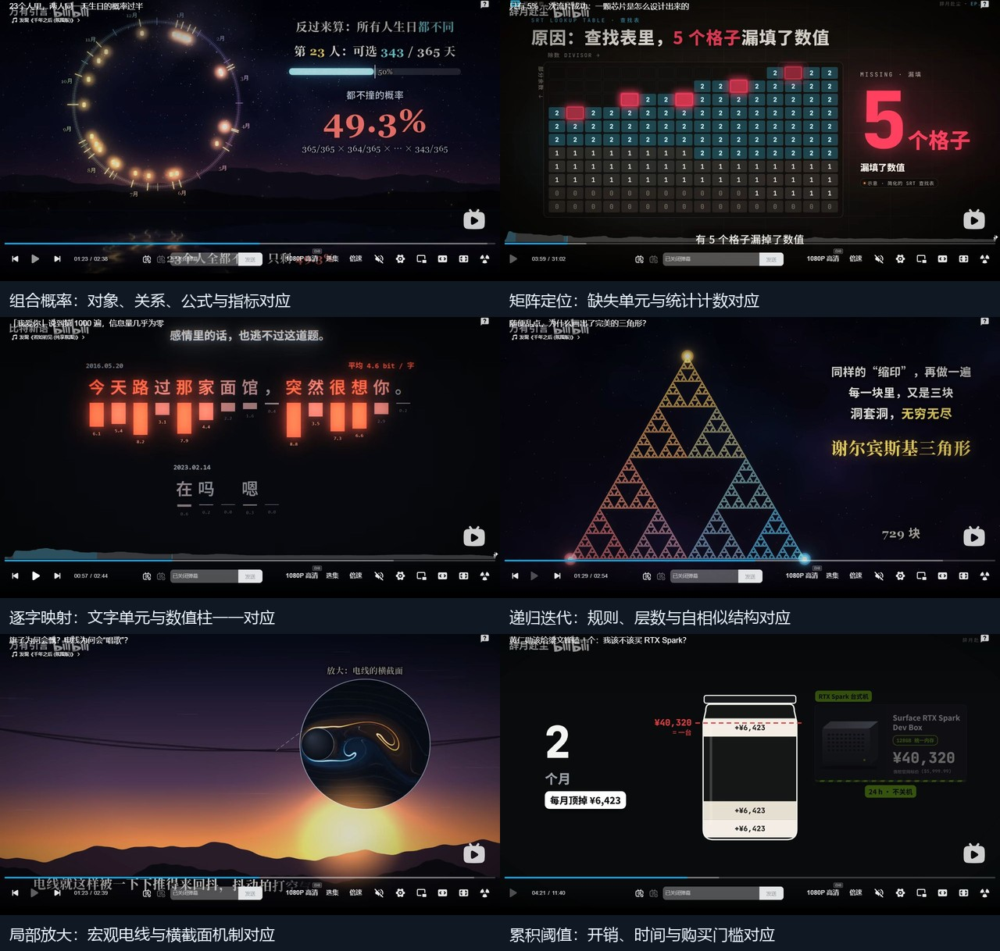

# 三个UP的30个视频：动画能力扩展研究

观察日期：2026-11-08至11-09，北京时间。前轮记录见[六视频初步研究](animation-capability-reference-study-2026-11-08.md)。

最新范围见[两位UP的57条视频完整清单与能力归并](animation-capability-full-study-2026-11-09.md)：比特新语全部26条、辞月赴尘2026年10月1日之后31条。本文件保留三个账号各10条的历史取样记录。

**本轮新增24个视频、80个有效观察位置，连同首轮6个，累计30个视频，每个账号10个。归并得到18类可研究的能力。** 相比首轮，新增价值最明确的是：文字/字段/矩阵与数据对应、组合概率、迭代累积、阈值决策、不同统计视图、多类型关系流、参数扫描与响应。

方法：在正常播放器中打开视频、播放定位并保存画面，再核对标题、视频身份及实际媒体时间。新增短视频每条至少3个有效位置；长视频3—4个位置，跨不同章节。时间均为约数，播放器取帧与显示可能相差一秒。已排除自动切到其他视频的错帧。这里确认的是画面构成、不同阶段的状态及可提炼机制，没有将分散取样当作逐片完整看完、全程运动连续性证明或科学结论验真。

上图从左至右、从上至下分别对应S03、C03、B04、S06、S05、C08。截图保留原视频标题和播放器上下文；下方说明为本次机制归纳。

## 一、比特新语：10个视频

主页：<https://space.bilibili.com/3494362707135250>。表中题名部分缩写，链接指向原视频。

| 编号与视频 | 时长 | 实际观察位置与画面 | 建议形成的能力 |
|---|---|---|---|
| B01 [压缩即理解](https://www.bilibili.com/video/BV1ot4z66EvR/)（首轮） | 03:08 | 00:55椭圆轨道、日地标签、扫掠区域与公式；01:33像素猫及行列/颜色标注；01:46概念字“猫”与重点文字 | 路径与区域联动、像素定位、形象到概念的对应过渡 |
| B02 [它被称为终成眷属的算法](https://www.bilibili.com/video/BV1nZxJ6xESS/)（首轮） | 02:42 | 00:26、00:51透视门廊与人物图标；01:30双语引文和重点划线 | 透视空间、对象分组、引文重点与空间隐喻。未据此确认逐轮匹配算法演示 |
| B03 [剃刀：每一个也许都要付钱](https://www.bilibili.com/video/BV1WkJk6VEqA/) | 02:40 | 00:16一条信息向右分叉并增密成网络；01:10轨道与第426/533/639/746天标记；01:38散点、拟合直线、残差短线和外推区域 | 分支图逐层展开、时间与路径位置对应、拟合/残差/外推联动 |
| B04 [“我爱你”说到第1000遍，信息量几乎为零](https://www.bilibili.com/video/BV1VVpo6gEMw/) | 02:44 | 00:31概率—信息量曲线；00:56每个字下方对应柱和数值，并比较平均bit/字；01:40密集彩色流线及指标 | 文字单元与数值图元一一对应、曲线探针；流线另作样式或场效果 |
| B05 [两个一模一样的地方之间，是不会起风的](https://www.bilibili.com/video/BV1zVpJ6yEk6/) | 02:42 | 00:16海面与日出反射；00:55球面地球、短粒子/线段与赤道热区标签；01:39海面和整体光照变化 | 球面标量场/方向场、球面粒子与标签、环境状态。海面的具体制作方式未确认 |
| B06 [看懂了熵增，就原谅了生活所有的力不从心](https://www.bilibili.com/video/BV1u1p56EEDW/) | 约02:51 | 00:31硬币微观排列、正反数量和组合大整数；01:12点阵人体、引文与37.0°C；01:59双发光点与情境字幕 | 离散排列与组合计数、轮廓转点阵、图形与数值对应。取样未见粒子扩散过程 |
| B07 [涌现：参数的史诗](https://www.bilibili.com/video/BV1vXHr6eEoN/) | 约02:42 | 00:32双对数散点与10⁴—10⁵的×10区间；00:55共137格、点亮3格和3/137计数；01:53年份与训练token量的对数散点 | 对数坐标、数量级区域强调、参数到状态矩阵与计数映射 |
| B08 [你不是不理性，你只是只有一次人生](https://www.bilibili.com/video/BV1mgHh6pEuf/) | 约02:42 | 00:16倾斜结论印章；00:55选择卡以虚线关联时间曲线；01:53“一万个人各抛一次”的网格与“一人抛一万次”的折线及不同平均指标 | 同一实验的不同统计视图、选择与曲线坐标对应、群体/时间聚合 |
| B09 [余波：吵架后的沉默，会传多远？](https://www.bilibili.com/video/BV1Kpa26dE9e/) | 02:44 | 00:31双黑洞、质量与弯曲网格；00:56网格两点、长度括号和32.4cm；01:54中心文字、多层同心亮环与光强指标 | 参数化网格形变、径向波/作用范围、两点测量与数值联动 |
| B10 [什么是37法则？](https://www.bilibili.com/video/BV13Aa66LEAW/) | 02:44 | 00:17候选柱序列突出No.24；00:56函数P(x)=-x ln x、最优点和横纵投影；01:40候选扫描与变化的标准线 | 序列扫描、阈值策略、函数极值/投影、接受与跳过事件 |

这一组最值得加入实验台的，是**数据与表示的精细对应**：一个字对应一根柱、一个参数对应一组格子、一个测量点对应一个值、同一组实验数据对应不同统计视图。黑底、金色、光晕、印章可以作为共享主题配置。

## 二、辞月赴尘：10个视频

主页：<https://space.bilibili.com/333553457>。

| 编号与视频 | 时长 | 实际观察位置与画面 | 建议形成的能力 |
|---|---|---|---|
| C01 [康宁vs肖特：零膨胀玻璃](https://www.bilibili.com/video/BV1dMxn6mE5P/)（首轮） | 41:45 | 05:10球棍晶格；12:10颗粒间隙、填充箭头和标注；20:16电磁炉模型、线圈与引线 | 晶格、受控填充、三维部件与标注对应 |
| C02 [9800X3D：两颗芯片怎么“长”成一颗](https://www.bilibili.com/video/BV1xQxy6iEaB/)（首轮） | 32:59 | 00:27芯片外观；05:29层状截面；20:00互连局部及热膨胀系数对照 | 整体到局部、剖切分层、结构与参数共同解释 |
| C03 [只有5%一次流片成功：芯片怎么设计](https://www.bilibili.com/video/BV1XcWw6XERW/) | 31:02 | 03:58查找表5个漏填单元高亮；11:11多层互连中的发亮路径；18:54版本A0…E5阶梯；25:57机柜与投资数值卡 | 矩阵单元定位、层间路径、迭代历程和状态事件 |
| C04 [一粒灰尘能毁掉一大片连接：混合键合](https://www.bilibili.com/video/BV1B4xy6XE3W/) | 26:37 | 03:27接点阵列与截面；09:39晶圆/设备与精度—速度曲线；16:14探针接触凹坑与翻边；22:19设备和部署信息卡 | 结构—曲线联动、接触点定位、局部受控形变 |
| C05 [每1000亿个硅原子只许1个杂质：硅片制造](https://www.bilibili.com/video/BV1i3x16XEB3/) | 23:31 | 03:04烧瓶、分子与沸点；08:33晶体、坩埚与反向旋转箭头；14:23密集平行细线阵列 | 工艺部件编排、运动方向对应、规则阵列与尺度说明 |
| C06 [宇宙射线粒子：谁在半秒里拦住错误](https://www.bilibili.com/video/BV1WQxk6ZEzw/) | 24:44 | 03:12芯片功能块；08:59车道轨迹与时间标记；14:51Length/Counter/DataID/CRC/Last字段与超时；20:46车舱/透明车体双视图 | 数据包拆解、校验与超时、故障因果过程、多视图 |
| C07 [内存怎么工作：等待的100纳秒](https://www.bilibili.com/video/BV1nXJY6yEMn/) | 16:11 | 02:15柱阵列与内部高度状态；05:55READ及行缓冲区；10:14单柱从阵列中突出、尺寸引线；13:42DDR5/HBM带宽和等待双指标 | 网格地址与数据搬移、阵列—单体承接、多指标对比 |
| C08 [我该不该买RTX Spark？](https://www.bilibili.com/video/BV1UDHg6eE2c/) | 11:40 | 01:42芯片结构并排对比；04:20月数、逐月开销容器与购买阈值；07:31GPU/CPU汇向共享内存；10:00公司/架构关系图 | 累积量与阈值、共享资源汇合、多类型关系网络 |
| C09 [活牛、盐巴和黄金，怎么变成一张纸](https://www.bilibili.com/video/BV1L9Ms6QE4o/) | 22:46 | 03:03商人与交换箭头；08:13金币阵列及部分抽取语义；14:11世界地图弧线网络；19:06票据数量与100:1兑换 | 数量集合拆分/转移、地理流向、比例换算与等价表达 |
| C10 [你的钱记在谁的账本上](https://www.bilibili.com/video/BV115Nj6vEA3/) | 约25:47 | 03:24货物流/资金流双色点线路径；09:16科隆/纽约双时钟；16:00城市背景引文卡；21:34连线上“拒绝执行”状态 | 多种语义流、共享时钟与时差、关系边门禁与失败后果 |

这一组可先补充大量二维能力：**矩阵、数据包、累计阈值、多类型连线、时序与失败状态**。真实感芯片、车辆和设备展示还需要资产流程；解释机制可先用明确的几何与结构实现。

## 三、万有引言：10个视频

主页：<https://space.bilibili.com/3747571411454030>。

| 编号与视频 | 时长 | 实际观察位置与画面 | 建议形成的能力 |
|---|---|---|---|
| S01 [滑梯怎么设计最快](https://www.bilibili.com/video/BV1sj4n6TEkp/)（首轮） | 02:37 | 00:23三条路径、小球、时间和排名；01:03滚圆生成摆线；01:51不同位置释放、同时到底主题 | 曲线竞速、几何构造、不同初值对比 |
| S02 [多开1个收银台，队伍为何短一大半](https://www.bilibili.com/video/BV1KY4h6KEu3/)（首轮） | 约02:52 | 00:27左右分屏、规则/随机到达、人数和事件标记；01:51忙碌程度与等待曲线 | 离散事件重放、分屏对照、对象与指标共用状态 |
| S03 [23个人里，两人同一天生日的概率过半](https://www.bilibili.com/video/BV1jv4F6YE7z/) | 02:38 | 00:34环形日期、23个人与253条关系；00:55第2人364/365与补事件概率；01:22第23人343/365、乘积和49.3%条 | 组合关系生成、逐项概率计算、对象—公式—指标联动 |
| S04 [无穷大也分大小](https://www.bilibili.com/video/BV1sD4z6dEiF/) | 约05:29 | 01:00编号门廊n→2n；01:21酒店整体与走廊；02:33小数集合；03:43房间亮灭与二进制对应 | 编号实体映射、有限窗口表达无限规则、序列与编码 |
| S05 [旗子为何会飘？电线为何会“唱歌”](https://www.bilibili.com/video/BV1WD4z6dESR/) | 02:39 | 00:34不同Re的绕流分区；00:55双色分离点和涡旋；01:23电线关联圆形横截面放大窗 | 参数状态对照、流线/涡旋、宏观—局部放大对应 |
| S06 [随便乱点，为什么画出了三角形](https://www.bilibili.com/video/BV12Y4h6NEFg/) | 02:54 | 00:37累计450个点；00:58“走一半”的嵌套三角形；01:29递归缩印与729块计数 | 迭代累积、固定随机种子、自相似、计数与几何对应 |
| S07 [搅完奶茶，珍珠为啥往中间跑](https://www.bilibili.com/video/BV1sDxy6TEQo/) | 02:36 | 00:16俯视水纹/珍珠；01:02杯体剖面、分层速度箭头；01:35圆柱空间中的螺旋轨迹与杯底聚集 | 俯视—剖面—空间多视图、速度剖面、受控输运 |
| S08 [旅行者号怎么把速度翻倍](https://www.bilibili.com/video/BV1SZxu6yE4K/) | 约02:51 | 00:17飞船接近静止行星及速度；01:07火车/小球类比与80+50=130；01:57木星/飞船质量量级和极小减速 | 参考系切换、类比承接、速度与质量数量级 |
| S09 [74人齐步走，竟把一座桥踏塌](https://www.bilibili.com/video/BV1WVno6pEYC/) | 02:56 | 00:18桥与行军；01:08弹簧灯笼、驱动节奏—幅值曲线、固有频率；01:59桥上人群、2100人与84%比例 | 参数扫描、振动响应、相位/群体统计联动 |
| S10 [大陆在漂移，第一个说出来的人](https://www.bilibili.com/video/BV1Wj4n6TEQU/) | 05:12 | 00:32南美/非洲轮廓；01:54大陆拼合与历史拒绝标记；03:22冰面木杆类比和历史年份 | 地图区域拆分/拼合、区域身份、时间与证据阶段组织 |

这一组适合形成**有明确规则、可复算的动画能力**。例如组合关系数、递归层数、映射规则和振动响应，都能从视觉与数据两个方面检查。流线、粒子轨迹、速度场及物理预测应有清楚定义；本次没有从画面推断参考视频使用了完整CFD、桥梁力学或天体仿真。

## 四、归并成18类能力候选

这里按机制合并，不按题材累计。表中“补强”表示已有绘制/固定样例基础，仍需参数化和新输入验收；“新增”表示需要补数据、约束或演化模型。难度为工程估计。

| 能力 | 参考 | 与实验台关系、建议路线 |
|---|---|---|
| 1. 路径运动、身份保持与到达事件 | B01、B03、S01 | 补强移动/身份追踪；HTML/SVG先做任意曲线和速度律，计时与位置同源 |
| 2. 图拓扑展开与复杂度变化 | B03、C08、S03 | 补图数据、布局与拥挤控制；小规模SVG，中等 |
| 3. 编号映射与实体重排 | S04、B10 | 补集合/映射规则；复用对象身份和移动，SVG中等 |
| 4. 文字、字段、矩阵与数值对应 | B04、B07、C03、C06、C07 | 新增统一索引与对应层，复用高亮/图表/算法；SVG中等，优先 |
| 5. 组合、概率与公式联动 | B06、S03 | 新增组合/概率状态模型；图元、公式、计数共用数据，SVG中等 |
| 6. 规则迭代与累积结构 | S06、C03 | 新增确定性迭代/事件序列；少量SVG、大量点Canvas，中等 |
| 7. 阈值、扫描与决策事件 | B10、C08 | 补策略状态、历史最优与累计量；SVG中等，优先 |
| 8. 函数、拟合与多指标权衡 | B03、B07、B08、C04、C07 | 补坐标变换、探针、残差和量纲；已有图表基础可复用，中等 |
| 9. 几何生成、扫掠与测量 | B01、B09、S01 | 新增几何约束与测量模型，复用描线，SVG中等 |
| 10. 图像、点阵与概念对应 | B01、B06 | 新增图像采样、语义分组与聚合；小规模SVG/大规模Canvas，中到高 |
| 11. 多视图与局部放大 | C02、C06、C07、S05、S07 | 建共享状态、目标锚点、投影和标签避让；跨多类效果共用，优先 |
| 12. 地图区域与地理网络 | C09、S10 | 新增地图资产、投影、区域锚点与弧线；二维SVG中等 |
| 13. 多类型语义流与边状态 | C06、C08、C09、C10 | 扩展过程动作：类型、方向、门禁、失败后果；SVG中等 |
| 14. 共享时钟、时差和统计视图 | B08、C10、S02 | 共享事件/样本×时间数据；数字、指针、过程与聚合一致，SVG中等 |
| 15. 参数场与粒子输运 | B05、S05、S07 | 新增二维/球面场及受控输运模型；Canvas/Three中高，先做说明性效果 |
| 16. 振动、径向传播与响应 | B09、S09 | 从有限一维波配方扩展到相位、阻尼、频响、二维场与测量；中高 |
| 17. 参考系、尺度与数量级 | B07、C07、S08 | 补坐标系、单位、对数尺度和视图转换；二维模型中等 |
| 18. 分层剖切、阵列与接触形变 | C01—C07 | 复用Three基础，补部件树、截面、接触约束、阵列身份和几何模型；中高 |

样式/资产层单独配置：背景星点、金色重点、柔光、描线光晕、印章、景深、海面或设备资产。它们影响观感和性能，可与上述机制组合；不单独计入18类核心候选。

## 五、建议调整后的落地顺序

首轮五项继续保留。本轮建议优先补以下8张实验卡，其中前6项可从HTML/SVG开始；局部放大作为多项共用的基础能力。

| 实验问题 | 最小输入 | 未参与调优的新输入 | 核心检查 |
|---|---|---|---|
| 怎样让文字/字段/格子与数值始终对应？ | 12字文本配权重柱；或8×8矩阵指定3个缺失格 | 长文本、标点换行、16×12矩阵、不同地址 | 索引、数值、位置和计数一致，无错配/丢标 |
| 加入一个成员，关系数与概率怎样共同变化？ | 10人逐步增加至23人，显示配对数和不碰撞概率 | 改人数、类别总数和分布假设 | 关系数量、概率、公式、图元一致；密集时仍可读 |
| 怎样看到简单规则累计成结构？ | 固定种子的“随机选顶点、走一半”迭代 | 换起点、种子、顶点规则、迭代次数 | 点数和规则可核对；跳回同一时刻结果一致 |
| 什么时候达到阈值或应当停止？ | 逐月开销与购买阈值；候选序列与停止策略 | 换费用、阈值、序列和策略 | 累计量、阈值、当前项、接受事件来自同一模型 |
| 同一数据换统计角度，结果如何不同？ | 样本×时间矩阵，同时显示网格、个体折线和聚合值 | 换样本数、时长、种子与聚合方式 | 所有视图消费同一数据；平均定义和单位明确 |
| 一条关系怎样表达多种流、拒绝和恢复？ | 货物/资金双向流，含一个拒绝事件 | 换方向、流类型、失败位置、超时阈值 | 对象状态、连线状态和后果一致，失败不会被画成成功 |
| 改参数时，响应曲线和主体怎样同步？ | 驱动频率扫描，显示振子与幅值曲线 | 换阻尼、固有频率、扫描速度 | 频率、相位、幅值、曲线探针来自同一模型 |
| 宏观与局部怎样保持对应？ | 电线与截面放大窗；阵列与选中单体 | 换目标位置、标签长度、布局及视角 | 锚点正确、同一对象可追踪、引线与标签不遮挡 |

后续扩展：球面场、二次环流、径向网格形变、三维接触、地图投影和参考系切换。复杂三维资产与更精确物理解算按具体需求投入，不应把所有研究任务绑在真实感渲染上。

## 六、接入现有实验台的边界

沿用首轮已核对的实现基础：39个固定样例、11类模块；基础显隐/高亮/移动/描线、过程状态、图表和算法，以及有限Canvas场/粒子与Three剖切配方。已有SVG形变要求相同路径命令结构，不能直接代表任意图像/文字转换。

共享能力包`explanatory-motion-v1`当前源码只准入HTML/SVG；正式创作适配约束为1280×720、24fps、单镜最长60秒并绑定录音与讲解节拍。Canvas/Three固定样例可复用底层，但还需要各自的生成、观察和正式取帧准入。本轮扩大参考研究，没有重新验收生产部署或创建上述实验。

具体落地时，每类能力应有：明确输入与数据/约束模型、可配置视觉表示、绝对时间重建、独立检查，以及新输入复测。技术检查通过与观看效果优劣分别记录。只有改对象数、尺度、文本和规则后仍有效，才适合进入共享能力发布。

特别保留的证据边界：本轮没有在熵增取样中看到扩散；没有把大陆漂移取样补写成海底扩张动画；没有把门廊隐喻补写成完整稳定匹配算法；没有由真实感判断原作者使用的工具。概率、物理、经济、产品规格与历史叙述均需在制作相应内容时另行核对。
