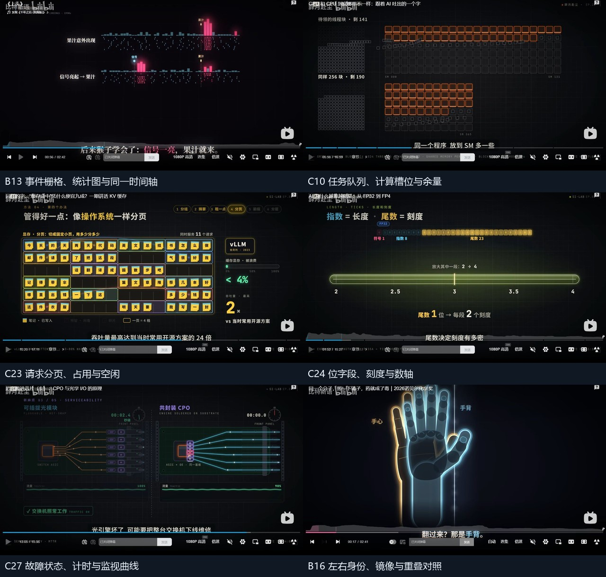

# 两位UP共57条视频：动画能力全范围研究

观察日期：2026-11-09，北京时间。

后续已补齐[万有引言100条研究](animation-capability-wanyou-study-2026-11-09.md)，三位UP的指定范围合计157个不同视频。本文继续保留两位UP共57条的原范围与统计。

**已按公开投稿列表补齐比特新语全部26条，以及辞月赴尘在2026年10月1日之后的31条，共57条。** 本轮新增39条、140个有效取样位置，复用前轮18条记录。逐视频记录见[比特新语26条](animation-capability-bit-full-2026-11-09.md)和[辞月赴尘31条](animation-capability-chip-full-2026-11-09.md)。

最值得沉淀的是：**一套数据同时驱动对象、时间、图表、公式和指标**。这批参考中大量芯片、算法、心理与科学解释画面，可以先用HTML/SVG建立可替换输入的能力；高真实感场景、密集粒子及复杂空间效果另需资产或渲染支持。

从左至右、从上至下：B13事件栅格与统计图、C10任务与计算槽位、C23请求分页、C24位字段与数轴、C27故障监视、B16镜像重叠。图像来自本轮播放器取样，不是实验台实现效果。

## 范围与观察方法

| 账号 | 核对范围 | 覆盖 | 复用前轮 | 本轮新增 | 新增位置 |
|---|---|---:|---:|---:|---:|
| [比特新语](https://space.bilibili.com/3494362707135250/upload) | 当前公开投稿列表全部视频，2026-10-01至11-06 | 26 | 10 | 16 | 48 |
| [辞月赴尘](https://space.bilibili.com/333553457/upload) | 2026-10-01之后，实际最早10-02、最新11-07 | 31 | 8 | 23 | 92 |
| 合计 | 两个指定范围 | **57** | **18** | **39** | **140** |

辞月赴尘的两页共59条投稿已按BV核对；日期边界相邻视频为10月2日和9月18日，第二页最新为8月9日，因此本次范围为31条。前轮两条7月的货币/金融视频不计入这31条。比特新语列表共26条，均纳入。这里的“全部”指观察时公开投稿列表，不包括不可见、删除或未来投稿。

延续此前明确的方法：在正常播放器中打开、定位并保存截图，再逐张核对BV、题名和实际媒体时间；新增比特视频每条3个位置，新增辞月视频每条4个位置。缓冲未完成的画面重取；光刻机视频中段改在08:59.83成功取样。三条诺奖相关视频进入B站活动页，仍核对了URL中的BV及播放器标题。

**这是覆盖全部指定视频的画面抽样研究，没有逐片从头到尾完整观看。** 可确认画面构成、不同阶段状态与表达需求；不能由分散截图确认全程运动、转场、音乐节奏、科学精度或原作者制作工具。时间为媒体记录点，截图与记录可能相差约1秒。长安视频一张普通网页布局的取样只保留可见播放器区域，不用于精细画质判断。

每个新增视频均有独立取样拼图，链接放在对应条目下；[机器可读范围与证据清单](../../evidence/animations-full-reference-2026-11-09/manifest.json)列出57个BV、完整题名、日期、复用/新增状态和取样时间。旧项保留前轮来源。

## 归并为24组候选能力

以下按可迁移的机制归并，不按视频或题材数量增加接口。编号B/C对应两份逐视频报告。难度和实现路线为工程判断，候选尚未实施。

### 优先补充的12组

| 候选能力 | 具体要形成的能力 | 画面依据 | 当前缺口与路线 |
|---|---|---|---|
| 1. 共享时间的多轨过程 | 阶段、事件、曲线、利用率与当前对象同步；重叠、空闲和完成状态可核算 | B13；C12、C20、C25 | 固定流程基础上新增统一事件/状态模型；先SVG，中高 |
| 2. 调度、槽位与资源池 | 任务入队、占用、释放、两组配额变化，归属与剩余数一致 | C10、C19、C22 | 新增资源容量、任务身份和分配规则；SVG，中 |
| 3. 序列、候选与缓存页 | 字符/token身份、查询锚点、接受/丢弃、片段复用、页分配/释放/碎片 | C19、C21、C23 | 普通token移动需扩为请求/页/槽位模型；SVG，中高 |
| 4. 字段、编码与数轴 | 数据包字段、bit分组、符号/指数/尾数、量化等级与数轴值对应 | C05、C24 | 新增编码/舍入/scale规则；SVG，中高 |
| 5. 端口与多类型链路 | 连接到指定端口，电/光/业务等关系分型，转换节点、路径选择和有效边 | C14、C27、C28、C29 | 现有连线/传递补端口和边身份；SVG，中 |
| 6. 公式、单位与多种表示联动 | 同一参数同时更新公式项、面积、频率、刻度、仪表与结果 | B11；C13、C17、C24、C30 | 新增可复算数值与单位层；SVG，中 |
| 7. 相同对象的多视图比较 | 两种条件、群体/时间统计、事实/反事实、图形与数值共享对象身份 | B18、B19、B21、B23 | 比较布局已有基础，补共享输入与视图映射；SVG，中 |
| 8. 阈值、预算与累计量 | 成本累积、损耗预算、差额、越界、未知值与区间，均有单位和条件 | B26；C06、C08、C18、C30 | 图表基础上补累计/计算/不确定性语义；SVG，中 |
| 9. 层级、阵列与单元映射 | 单体→分组→系统，像素/矩阵索引、数量乘积、选中子集、逻辑容器与图标比例 | B01、B14、B20；C07、C16、C20、C25 | 新增部件树、图像到网格映射、层级归属与数量预算；SVG优先，大规模再评估Canvas/Three，中 |
| 10. 故障、校验与诊断 | 异常发生、超时/CRC、故障位置、维修计时、运行曲线、重放比对 | C05、C20、C27 | 新增因果事件、预期/实际值和诊断状态；SVG，中高 |
| 11. 结构、剖面与局部视图 | 整体与截面/放大窗保留同一部件身份，标注和连接位置可追踪 | C01—C04、C07、C18 | 固定剖切基础上补通用部件/视图映射；二维SVG，中；空间剖切Three，中高 |
| 12. 对象、道具与标注绑定 | 角色手/背附着道具，部件绑定引线，镜头变化后仍跟随 | B03、B08、B09；C09 | 新增父子关系、局部锚点、坐标变换；SVG，中 |

### 第二批研究的8组

| 候选能力 | 具体要形成的能力 | 画面依据 | 路线与验收重点 |
|---|---|---|---|
| 13. 参数曲线与几何测量 | 圆锥曲线轨道、偏心率、焦点、轨迹对象、网格与两点测距 | B01、B02、B24 | SVG几何模型；改参数后图形、位置、说明、测量一致，中 |
| 14. 镜像、旋转与重叠对照 | 正反/左右不同身份、半透明重叠与对应标记 | B16 | 配对SVG资产先做；三维分子另建连接模型，二维中、三维中高 |
| 15. 树与网络的局部聚焦 | 分枝层级、目标节点、指定路径、邻域压暗与解释 | B07、B10、B17、B23 | SVG小图或Canvas大图；有明确节点/边数据，中 |
| 16. 区域、轮廓与点云 | 遮罩采样、人体/脑轮廓、热点与局部选区 | B15、B17 | 固定随机种子；目标区域与点身份稳定，Canvas原型，中高 |
| 17. 地图路线与区域数据 | 地理底图、路线端点、沿线事件、城市/区域热点 | B03、B22；C06 | SVG底图与锚点数据；缩放后端点、标签一致，中 |
| 18. 流线、方向场与传播尺度 | 翼型/球面线场、力箭头、波形和空间周期、距离=速度×时间 | B05、B12；C17、C30 | 受控SVG线场先做；传播需量纲模型，求解器另验收，中高 |
| 19. 离散规则、收益矩阵与回合计数 | 硬币排列、组合计数、候选扫描、策略收益表、重复回合与累计总分 | B15、B20、B25、B26 | 可复算规则驱动格子/公式/数量；策略、当轮收益与累计总分同源，SVG，中 |
| 20. 工艺阶段与受控形变 | 工具接触、局部凹陷、材料层、坏块、累计成本与良率 | C02、C04、C18 | 二维过程先做；真实材料形变需另建模型，中高 |

### 独立投入的4组外观与资产能力

| 候选能力 | 画面依据 | 可复用范围及主要投入 |
|---|---|---|
| 21. 分层剪影、纸张与场景 | B03、B09；C31 | 远中近景、纹理、竖排引文、配色、遮罩光束；先建立可替换资产与图层，中 |
| 22. 主题与后期叠加 | B06、B07；C31 | 光晕、星点、水滴纹理、扫描线、局部条带/色通道偏移；独立于内容层，中 |
| 23. 密集粒子与程序化纹理 | B02、B06；C31 | 尾迹、盘状点群、丝状噪声、辉光；Canvas/着色器原型和性能预算，中高 |
| 24. 写实资产与空间镜头 | C01—C04、C17、C30 | 芯片、主板、设备、材质、灯光、遮挡、镜头；资产流程及Three支持，高 |

水滴图层不等于水膜仿真；流线外观不等于CFD；星系点群不等于N体求解；相邻齿轮不等于传动约束。若实验卡的目的包含物理预测，应另外定义模型、单位、边界条件和验证基准。

## 首批8张实验卡

建议先实现这些有明确输入与验收方法的能力，再扩视觉主题。它们可以覆盖多个视频的解释需求。

| 实验卡 | 最小输入 | 应输出的联动画面 | 留出输入与验收 |
|---|---|---|---|
| 1. 一条时钟驱动多轨过程 | 计算/通信事件、资源、有效/空闲分类、总时长 | 甘特条、当前阶段、模块高亮、利用率及公式 | 更换重叠区间与时长；并集/交集统计正确，跳转/倒回相同时刻一致 |
| 2. 队列分派与资源调配 | 任务ID、到达/结束事件、槽位容量、组归属 | 入队、占用、释放、余量、两池图标分区 | 4槽改6槽；16个资源在两池间变化，总数守恒且利用率分母正确 |
| 3. 序列候选与分页缓存 | 三个请求、token/片段ID、接受状态、页大小 | 查询锚点、接受/丢弃段、页归属、占用/空闲、容量与成本 | 页大小4改8，释放请求再追加token；身份、碎片、成本同步 |
| 4. 位字段与量化数轴 | 小规模输入数值、编码格式、舍入、共享scale | bit字段、可表示刻度、数值标记、量化误差 | 改尾数位数/scale/离群值；编码解码与误差可独立复算 |
| 5. 有类型的端口网络 | 节点端口、电/光边、转换节点、路径、镜面方向、损耗 | 类型着色、沿路对象、重配路径、输出功率与单位 | 换输入端口和镜面方向；端点/反射正确，2dB功率透过率约63.1% |
| 6. 一个参数的多种表示 | C、V、f和公式关系，数据性质/单位 | 公式高亮、V²面积、频率波形、功耗仪表 | V翻倍时V²项×4；图形和数值同源，未知值保留未知状态 |
| 7. 相同对象的条件对照 | 两组条件、同一实体/事件ID、统计规则 | 双面板、结果、参考线、事实/反事实标签 | 换条件和实体数；共同部分身份不变，比较基线和统计口径明确 |
| 8. 层状结构与局部解释 | 部件树、层、接点、截面、工具锚点 | 整体/局部/剖面、层间路径、引线和当前工序 | 2层改5层并换尺寸；对应部件稳定，剖面与整体连接一致 |

8张卡可复用相同的实体身份、时间、单位、分组和标注机制，但调度、分页、编码、反射等仍各有领域规则。不能通过一个万能视觉模板代替这些规则。

## 如何进入实验台的能力体系

沿用前轮代码核对的边界：目前实验台有39个固定案例、11个模块；基础动作、图表、算法、流程、Canvas场和Three结构已有样例。SVG morph受同路径命令结构限制，Canvas场和Three场景也各有固定输入范围。固定样例可运行、Agent接受新输入能生成、共享能力包正式准入，是三个不同状态。

首批可优先走现有HTML/SVG正式路径：给每张卡记录输入数据、事件规则、渲染对象、时间映射、参数范围、参考BV/时间和验收结果。Canvas/Three作为后续独立后端验证生成、观察和最终渲染支持，不因为本次列了候选就标为已经可调用。

建议每张卡至少保留一个最小输入和一个改变对象数、文字长度、单位或边界条件的留出输入；同一输入换主题仍应保持数值和身份一致。正放、跳转、倒回、固定时刻导出应一致，随机效果使用固定种子或预计算事件。数据“示意/假设/估计/未知/来源”的性质也应进入输入，而不是在渲染时随意补全。

本次完成的是57条视频的取样研究、证据整理与能力设计；这些候选尚未在实验台实施。此前[30条扩展研究](animation-capability-expanded-study-2026-11-09.md)还保留万有引言的10条观察，可与本报告共同使用；本次57条的计数只包含用户指定的两个账号及日期范围。
