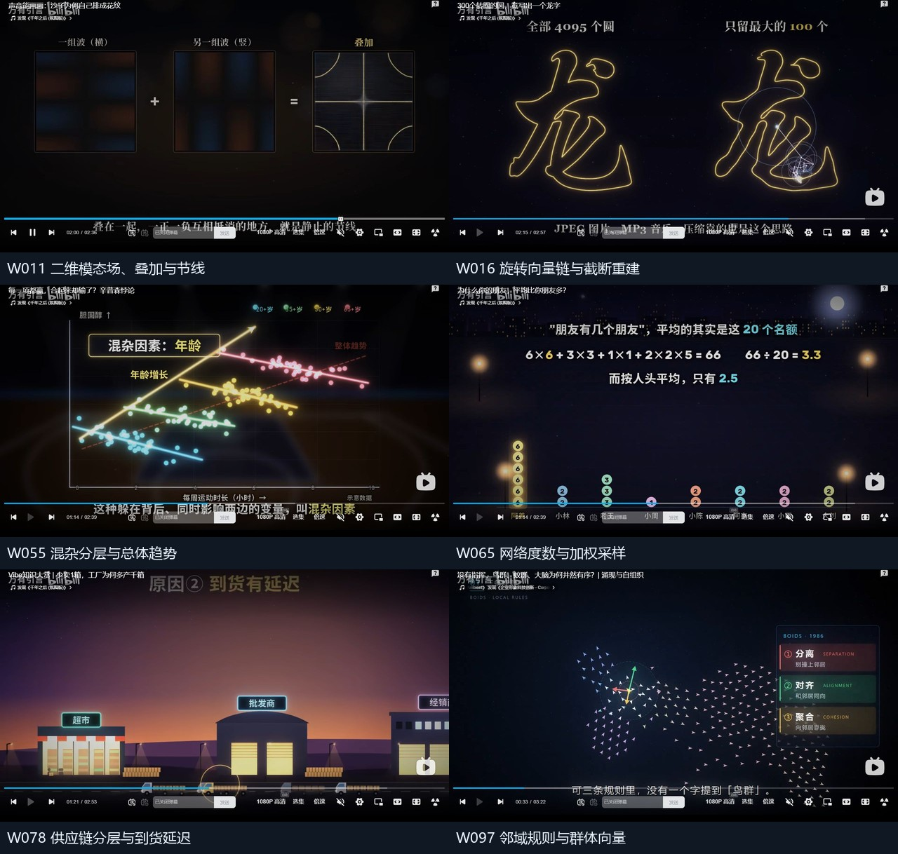

# 万有引言100条视频：可沉淀到动画实验台的能力

观察日期：2026-11-09，北京时间。状态：参考研究与功能建议，尚未实施。

**万有引言当前公开投稿100条已全部纳入逐视频总结。** 本轮新增90条、285个播放器画面取样位置，复用前轮10条。完整题名、BV、列表日期/时长、实际取样时间、画面事实、实现路线及验收条件见[100条逐视频报告](animation-capability-wanyou-full-2026-11-09.md)。

最值得优先形成的是：**对象群体与统计联动、参数化几何与公式联动、规则驱动的步骤执行、同一场景的主题切换**。更有辨识度的圆链画字、二维节线、蚁路、群体运动和反应扩散也能做，但需要各自的计算规则与渲染支持。

从左至右、从上至下：W011二维模态叠加、W016圆链重建、W055混杂分层与总体趋势、W065网络加权采样、W078供应链与到货延迟、W097群体邻域。图中是参考视频画面，不是实验台已实现的效果。

## 覆盖范围与证据精度

| 范围 | 视频数 | 证据 |
|---|---:|---|
| 本轮新增 | 90 | 每条3个位置；媒体时长超过240秒的15条各4个，共285个实际位置 |
| 复用前轮截图观察 | 8 | 25个保留的有效位置，只使用前轮已核对的白名单 |
| 复用前轮文字观察 | 2 | 滑梯、收银台共5个约秒记录点，未保留独立截图，不升级为精确时间证据 |
| 合计 | **100** | 98条有可查看的取样拼图，另2条明确保留文字证据限制 |

[公开投稿列表](https://space.bilibili.com/3747571411454030/upload)三页为40/40/20，按BV去重100条，列表日期从10月14日至“5小时前”。保留“5小时前”“17小时前”的原文；“全部”指观察时可见的公开投稿，不包含不可见、删除或未来投稿。播放器实际时间与列表时长分别记录。

**这是覆盖全部视频的截图抽样研究，没有逐片从头到尾完整观看。** 可以总结画面结构、参数表示和分散阶段状态；全程运动、转场节奏、原作者使用的工具、科学结论和求解器准确性不在本次验证范围。逐视频正文将直接观察与工程建议分开；没有用题名补出未见过程。

本次与此前[比特新语26条、辞月赴尘10月1日后31条](animation-capability-full-study-2026-11-09.md)合计，用户指定范围共**157个不同视频**。万有引言10条旧观察只在本账号100条内计一次，不另外增加总数。[证据清单](../../evidence/animations-wanyou-reference-2026-11-09/manifest.json)保留本账号100个BV及新旧来源。

## 归并为18组候选能力

以下按可迁移规则归并；同组可共享数据与视图，但不同领域规则仍分别实现。W编号均对应[逐视频索引](animation-capability-wanyou-full-2026-11-09.md#100条投稿索引)。难度及先后为工程判断。

### 优先形成的8组

| 候选能力 | 应能生成的效果 | 主要依据 | 实验台需补什么 |
|---|---|---|---|
| 1. 群体筛选与统计联动 | 人物/车辆/点阵按条件退出、分组、重排，计数、均值、分布同步变化 | W006、W009、W027、W029、W081 | 稳定实体ID、观测掩码、筛选规则与聚合；SVG，中。缺失样本保留未知，不能当零 |
| 2. 条件概率与加权对照 | 总体→子集→条件分母，分组与总体结果并列，公式中的人数可追到对象 | W003、W055、W065、W074、W080 | 集合账本、计数/权重/分母与舍入；SVG，中。组内比例不能直接取算术平均 |
| 3. 随机路径、落桶与账本 | 小球走路径落槽变直方图；财富曲线、下注与余额同步，理论分布和样本并列 | W015、W038、W066、W087 | 种子或预计算事件、分桶、支付规则、停止边界；SVG小样本，Canvas大样本，中 |
| 4. 规则表与逐步执行 | 开关/纸带/格子按规则更新，牌序置换，当前指令、状态、朝向、输出序列同步高亮 | W022、W043、W044、W070、W091 | 显式转移表、步号、状态快照和边界；SVG先做，中。密码查表、电路、合法置换、元胞、纸带解释器各有规则 |
| 5. 多轨事件与资源状态 | 排队/登机时空图、库存与在途订单、奖励与存量、繁忙/空闲曲线，在同一时钟下重放和比较 | W007、W023、W067、W078、W079、W085 | 事件日志、资源容量、身份归属、延迟和统计口径；SVG，中高。库存、奖励反馈、跟驰、等待各自建模 |
| 6. 参数、公式与坐标同源 | 参数改变时，公式项、点/向量、面积、刻度、误差和仪表同步更新 | W014、W028、W040、W071、W079、W099 | 数值计算、单位、定义域、线性/对数尺度与未知值；SVG，中。矩阵变换可先从二维做起 |
| 7. 几何生成与度量 | 模运算连弦、路径族、圆周逼近、多边形铺砌、转角对应支撑宽度和测量曲线 | W002、W024、W028、W036、W056、W057、W092、W095 | 曲线/轮廓数据、构造规则、几何度量和标签锚点；SVG，中。度量来自模型，不能独立编数字 |
| 8. 同一场景的主题与遮罩对照 | 固定布局切换配色、描边、纹理和图标；相同色块换背景；注视点、遮罩与视野坐标对应 | W034、W075、W077、W090 | 语义场景树、主题参数、对象锚点、色彩/遮罩规则；SVG/HTML，中。像素化后端另验收；本轮只见3种画风 |

这8组能先走现有HTML/SVG正式路径。它们复用已有显隐、移动、描线、图表等绘制基础，同时补齐输入和规则；不能把固定案例可播放等同于Agent已能根据新输入生成。

### 第二批及独立实验的10组

| 候选能力 | 可迁移机制与依据 | 实现路线与主要边界 |
|---|---|---|
| 9. 图关系、约束与传播 | 弱联系、阈值级联、S/I/R、图着色、边导通、蚁路强化：W032、W035、W052、W062、W072、W074、W082 | SVG小图/Canvas大图；补节点/边身份、邻域、更新策略和图布局。传播、着色和导电不能共用一个无定义的“网络算法” |
| 10. 相位、频谱与路径重建 | 周期阵列、音程比、圆链首尾相接、保留系数的近似对照：W016、W019、W042、W046 | 少量圆SVG、大量圆Canvas；补频率/相位、复系数与路径采样。周期重合不证明存在耦合锁相，圆链重建也不是SVG morph |
| 11. 地理身份与投影 | 大陆拆合、热点随年份变化、球面/平面锚点对应、纬度失真：W001、W010、W017 | SVG地理数据与投影先做，球面Three后接；需区域ID、坐标和尺度函数。连续展球转场未由截图确认 |
| 12. 参考系、局部视图与光路 | 同一事件的速度变换、俯视/剖面/空间映射、镜面/水滴出射方向：W005、W026、W037、W039、W040、W060 | SVG变换/几何光路先做；矢量、法线、单位、参考系进入输入。单条时延约束不等于完整定位，42°需注明主虹等适用条件 |
| 13. 轨迹集合、微扰与参数扫描 | 初值微差、多轨迹束、误差/区间、分岔点云与局部放大：W025、W073、W098 | SVG小规模、Canvas大样本；双摆、天体和迭代映射分别验证。区分模型敏感性与积分器数值不稳定，不宣称天气预测能力 |
| 14. 局部规则与群体运动 | 循环竞争、Boids、迁居、交通波、资源选址：W012、W051、W083、W085、W093、W097 | Canvas状态/粒子加SVG说明；补邻域、时间步、更新顺序与边界。统一状态接口，分别实现生态、鸟群、交通等规则 |
| 15. 二维场、介质与生成图案 | 模态叠加与零值节线、可激发波、反应扩散、波函数/密度、六角扩散与生长：W011、W020、W049、W094、W097、W100 | 解析模态先验证，其他场分别建规则/求解器、边界与稳定性条件；Canvas/Three独立准入。已有65点一维波不能代表通用二维场 |
| 16. 递归、尺度与迭代预算 | 迭代累点、自相似、沿轮廓步进、分形与精度对照：W008、W028、W095 | SVG小规模结构、Canvas复平面/大点集，三维分形另做；定义步数、误差、残段规则、固定种子和性能上限 |
| 17. 分层场景、实体转换与叙事资产 | 蜡烛、船、森林、人物道具、显微/宏观类比，阳光和芯片阶段输入输出：W010、W014、W018、W037、W050、W059、W064、W084、W088 | 先建立可替换SVG/位图资产、父子锚点、层次与阶段；场景与过程对象分开。同一能量历经转换不等于同一光子始终不变 |
| 18. 结构、镜像与受约束形变 | 分子连接/手性、相对关节、孔洞锚点与杯—环形态对照：W045、W084、W088、W096、W100 | 二维资产和连接图先做；Three需要对应网格、骨架、孔洞/自交检查。离散形态不证明完整同胚，任意模型自动变形不在现有morph能力内 |

这10组中，图/几何/少量相位可以继续从SVG原型推进；大点集、网格场、空间资产和求解器应独立验证输入生成、观察、性能及最终渲染。不能仅因浏览器能显示Canvas/Three就列为共享包正式能力。

## 首批8张可验收的实验卡

每张卡至少换一组对象数/参数/规则的留出输入；建议再用另一种题材复用同一机制。以下为建议设计，不是已经创建的站内实验。

| 实验卡 | 最小输入 | 联动画面 | 留出输入与验收 |
|---|---|---|---|
| A. 群体筛选与均值 | 12个带ID/数值对象、2轮筛选条件 | 对象退出/重排、人数、均值、历史柱图 | 改阈值和人数；保留对象、均值和柱图独立复算一致，缺失值不算零 |
| B. 条件总体与加权合计 | 两类人群、条件标签、成功/失败计数 | 总体点阵、筛选掩码、分组比例、总体比例与公式 | 仅改组大小；总体按实际分母加权，子集ID不丢失，各条件数字不跨阶段拼接 |
| C. 路径到分布 | 6层左右选择、概率、100次样本、种子 | 单球路径、在途/已落、槽计数、理论/样本分布 | 改为偏置概率及8层；每个终点与槽一致，已落+在途=已发，倒回不增样本 |
| D. 规则表执行器 | 有限纸带、状态/读值转移表、初态、步限 | 当前格、指令、状态、写入、移动、输出/历史 | 改一条规则并换初态；逐步状态可核对，跳转与逐步执行一致，超时不标为永不停机 |
| E. 库存与延迟事件 | 顾客订单、库存、采购事件、运输延迟 | 顾客/商店/上游多轨、订单、在途、库存曲线 | 改延迟/需求；订单和物料账本分别对账，未到货不提前加库存；正放/倒回同刻一致 |
| F. 参数与坐标/公式 | 二维矩阵、点集、基向量、同一时间参数 | 基向量像、全局点变换、面积/方向、行列式与公式 | 改成奇异矩阵和负行列式；点像、面积与det同源，不重复来源中det文案的不一致 |
| G. 轮廓测量与转角曲线 | 圆/非等宽轮廓、角度、支撑线与采样精度 | 当前轮廓、支撑宽度、角度游标、完整宽度曲线 | 替换轮廓；当前数值对应曲线上同角度点，单位一致，不把当前值当曲线峰值 |
| H. 同场景主题切换 | 一个带对象ID/标签/图层的SVG场景、3套主题参数 | 同构图的配色、线条、纹理/图标对照 | 换场景与长文字；身份、关系、数值和布局语义稳定，缩小可读，像素化不在未实现时冒充已有 |

A/B/F可先建立对象、集合、参数与视图的共享基础；C/D/E增加事件与状态重放；G补几何模型；H把外观参数与内容数据分别管理。随后优先做小图传播、16项以内圆链重建，再决定是否投入密集Canvas场和Three资产。

圆链的建议独立验收是：输入一条有序闭合路径，计算系数；圆端点等于各旋转向量和；左右保留不同系数时使用同一相位，并能计算重建误差。二维模态的建议独立验收是：输入已知解析模态、系数、边界；场值等于逐项和，零值节线与采样一致。两项均不能只靠复制原片轮廓或花纹通过。

## 与现有能力体系的关系

前轮核对基线为39个固定案例、11类模块；基本动作、图表、算法、流程、有限Canvas场和Three结构已有样例。SVG morph受同路径命令结构限制，已有场/三维场景也有固定输入范围。**固定样例能运行、Agent能接受新输入生成、共享包正式准入，是三个分别验收的状态。** 本次只完成候选设计和证据整理。

新增机制可复用此前57条研究中的实体身份、共享时间、单位、分组、锚点与多视图；本账号进一步明确了筛选分母、加权抽样、随机停止边界、规则表、圆链系数、二维场与局部邻域等需求。无需再按题材新增“生日模块”“鸟群模块”“超市模块”；需要把各自领域规则作为可更换输入/适配器，同时让视图引用相同状态。

每个候选应记录：输入及范围、规则/来源、模型时间、实体/关系、输出视图、随机种子或事件日志、参考BV与实际位置、留出输入及验收结果。示意、预计算、实测、未知分别标注；任意时刻定位、暂停/倒回、预览和导出应给出一致状态。

## 不能从参考中直接接纳的结论

部分取样处在数值揭示或不同参数阶段：W048末个位置仅显示到4.7亿光年；W054的1/N是责任份额示意，不是行动概率；W057当前宽度与曲线峰值不同；W076取样展示180°对照，不能补写已见完整137.5°过程；W080不同位置使用不同筛查参数，不能跨阶段拼接公式。W099首帧“降维det=0”与当前矩阵卡det=-0.64不一致，建议自行计算验收。

W063三张主要是果酱陈列，没有看到完整24/6组转化率对照；W090只取到3种画风；W094只看到探测器存在；W096只见分散形态。这些条目仍有资产、布局或机制建议，但不能扩大为已观察全片演示。旧旗子视频的自动跳转帧已排除；旧大陆视频也没有据题名补写未见的完整磁条带动画。

历史、医学、奖项、物理与数学结论均未由本次截图研究独立验证。若某实验卡承担预测或教学计算，应补模型假设、来源、单位、边界和独立算例，而不是以视频外观代替计算证据。
