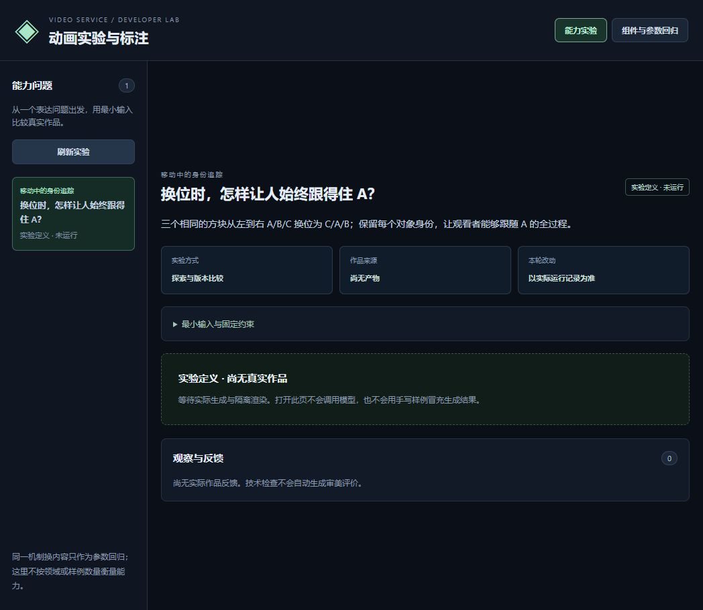
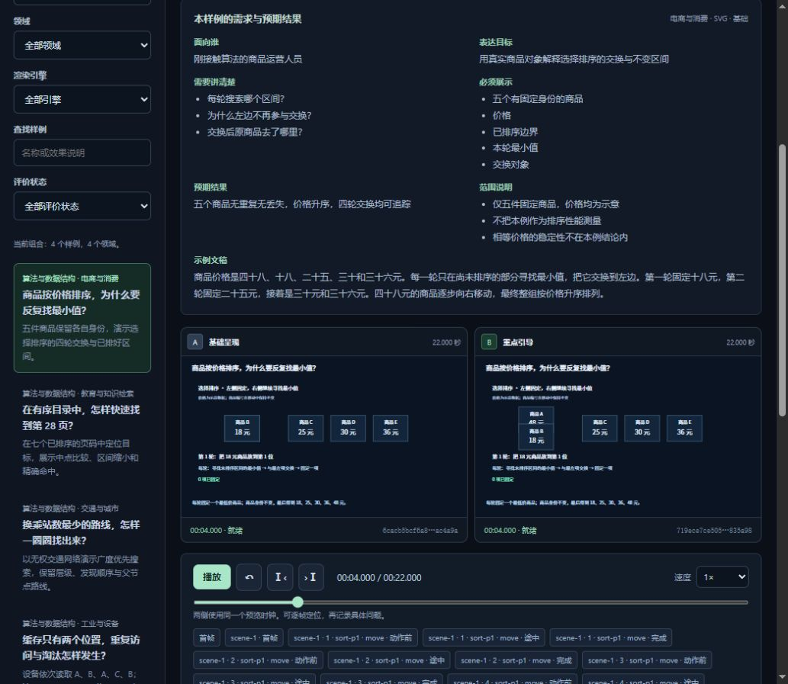
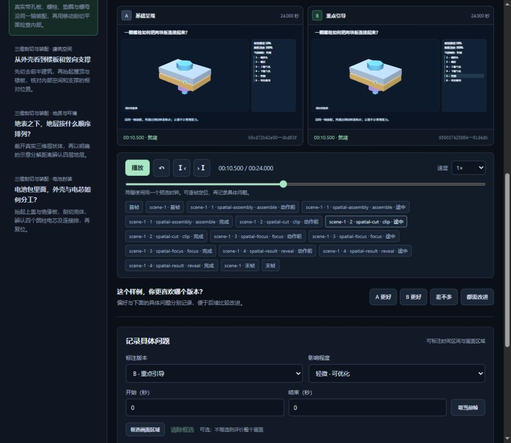

# 动画实验与标注页面实测

2026-11-08，北京时间。入口：[动画实验室](https://video-service.panghuer.top/dev/animations/#experiment-identity-tracking)。本次通过正常浏览器体验页面，未修改服务代码、进入服务器或启动生产视频任务。

**作为开发评测工作台，已经有用：可以按表达目标选择样例、同步比较两个版本、逐帧定位并保存具体意见。指定的身份追踪能力实验仍停在定义，没有实际作品或可见启动入口，尚不能评价它的生成效果。** 本次另实际播放了四组固定回归样例，保存并核对7条站内记录（4条偏好、3条具体建议）。

## 入口与身份追踪实验

先前直接访问不带尾斜杠的 `/dev/animations`，页面只显示 `{"detail":"Not Found"}`；用户补充的 `/dev/animations/#experiment-identity-tracking` 能正常打开。因此，先前结果只适用于旧路径，不能据此说动画实验室未上线或整个服务不可用。建议统一入口并让不带尾斜杠的地址正常跳转。

指定实验的问题清楚：“三个相同的方块从左到右 A/B/C 换位为 C/A/B，怎样让人始终跟得住 A？”固定约束包含1280×720、24fps、8秒、前1秒静止、6.5秒前完成换位，以及对象起终点与外观。它把表达目标转成最小输入，比单纯增加不同领域的样例数量更有检验价值。

但打开及点击“刷新实验”后，页面均为“实验定义 · 未运行”“作品来源：尚无产物”，观察与反馈为0；页面未见启动、选择运行方式或获取作品的下一步入口。**本次没有运行该能力实验，也没有用其他固定样例代替它的作品。** 如果这里只负责展示外部运行记录，宜直接说明作品从哪里来、如何关联到实验；如果支持站内执行，应提供明确的启动、进度、失败与重试流程。

页面明确区分“固定代码配方”和模型创作能力，说明打开实验页不会调用模型，不用手写样例冒充生成作品，也不将技术检查自动写成审美评价。这些边界表达值得保留。

## 实际使用范围

组件区显示39个固定样例，覆盖框图、过程动画、跨镜衔接、Canvas、三维、图表、算法、界面操作、公式、剖切装配及波形等模块。本次只实际播放下表四组，没有逐项检查全部39个样例。

| 样例 | 实际操作与结果 | 产物评价 |
|---|---|---|
| 实验样本：复检保留同一身份，24秒 | 双版本播放到结束；定位返回途中的9.720秒及末帧；下一帧到9.762秒，再上一帧回9.720秒 | B把返回路径贴近流程卡片，比A悬在卡片上方的回路更容易跟随；已检查位置均保留“样本01”。不据此声明全程无任何身份或运动异常 |
| 商品按价格排序，22秒 | 播放到结束；检查首轮交换中点4.000秒和末帧21.958秒 | 最后从左到右为B/C/D/E/A，价格18/25/30/36/48元，5个身份保留；交换途中A完全重叠，B仍部分遮挡 |
| 扩容之后，排队和延迟如何一起变化，22秒 | 双版本播放到结束，查看联动曲线、队列和实际完成量；记录“差不多” | 能将队列、容量、吞吐与示意延迟放在共同时间窗口；最后显示队列0、延迟80毫秒、完成量/容量4/8。数字是页面明确标注的示意数据，不能当作真实服务性能。已观察画面中A/B差异较细 |
| 一颗螺栓如何把两块板连接起来，24秒 | 播放到结束；查看初始分离、10.5秒剖切检查点与结束状态；试用0.5倍并恢复1倍 | 能看到装配和末尾内部结构，B增加部件列表高亮；主体与图例偏小，剖切面的位置、方向及零件对应还可讲得更直观。未评价工程尺寸、强度或受力 |

模块筛选、搜索“商品”及无匹配组合均实际使用：搜索得到排序与单价推导两个样例；再限定三维模块时明确提示调整筛选组合。刷新页面能保留三维样例的直达定位及已保存意见。标注包含版本、时间、问题类型和影响程度，原始意见与偏好分别记录。

播放、逐帧与检查点定位已验证；没有将同一时钟或状态文字等同于逐帧渲染同步证明。所有样例均明确标为无旁白技术样例，本次没有生成或验收配音、字幕、原生MP4或生产流程。

## 有证据的问题与建议

### 1. 换位时仍遮挡对象身份

排序首轮4.000秒的A版中，两张商品卡处在同一位置，前一张身份不可见。B版改用上下错位路径，方向更好，但两卡仍有交叠，商品A的价格不够清楚。可见DOM的画布坐标显示：两卡均高116，A版位置均为x195/y265；B版位置为x195/y227及x195/y303，纵向仅相差76，仍有40的重叠高度。这里的数值来自内层画布坐标，不能直接当作外层缩小预览的屏幕像素。

建议让交换对象走有足够净空的不同轨迹，间距覆盖卡片完整高度并留白。验收应逐轮查看交换前、中、后：编号和价格持续可辨，没有对象丢失、重复或被对方完全挡住，末帧仍保持正确升序。本次问题是观看时的遮挡，不能据此说排序逻辑错误。

### 2. 默认预览与定位操作不便于仔细评价

本次默认窗口中，侧栏加双列画面将源画面缩得很小，内部关系标签、状态和三维图例难读；页面未见单版本放大或全屏入口。点击位于下方的动作检查点时，页面会将按钮滚入视口，预览上部随之离开屏幕。

建议增加单侧放大、全屏与保留共同时间点的切换，并让画面或控制区保持可见。验收：在约千像素宽的窗口中，可以看清每个对象的名称和关键数值，定位后无需反复上下滚动才能比较画面。

### 3. 检查点与版本比较还可以更容易理解

复检样例有大量检查按钮，直接展示`scene-1 / request / transfer / set_state`等术语，占据很大区域。开发者可以使用这些精确定位，但第一次评价的人需要先理解内部命名。A/B普遍标为“基础呈现／重点引导”，部分样例的差异较细，需要自行找出究竟改了什么。

建议默认展示“初检失败、返回复检、复检完成”等关键阶段，把详细动作展开；同时给出该样例的具体变化摘要，例如“返回路径改到卡片下方”“交换采用上下错位路径”。保留技术信息用于排查，并支持隐藏版本说明后再盲评。验收：评价者能迅速定位语义阶段，并在需要时查看对应动作与精确时间。

### 4. 三维剖切需要更明确的视觉引导

10.5秒检查点显示剖切进度50%，但画面仍接近完整装配体，初学者难以辨认剖切面在哪里、往哪移动；末帧确能看到内部结构，不能将前一帧解释为剖切功能失效。B主要高亮右侧清单，零件名称与模型本体的对应还不够直接。

建议显示半透明剖切面或描边，使用部件高亮与指示线对应名称，提供局部放大。验收：初学者能指出垫圈、板孔和螺母的位置，并能说明当前切面的方向；不将颜色变化当作工程强度或完成验收的证明。

## 已保存的站内反馈

| 样例 | 已核对的记录 |
|---|---|
| 复检 | “B更好”＋0—24秒的预览可读性、定位交互建议 |
| 排序 | “B更好”＋4.000秒的卡片遮挡问题，影响程度“明显” |
| 图表 | “差不多” |
| 三维装配 | “差不多”＋10.5—24秒的剖切表达建议 |

共7条，包含4条偏好、3条具体建议；保存后可回看，刷新后也核对了相关记录。本次没有把“效果可接受”或“还需改进”当作自动技术验收，也没有修改生产效果。

“导出回归标注”入口已实际尝试，本次未取得可核验的导出文件，故导出能力保留未验证；现有证据不足以归因为服务缺陷，不列入问题清单。时间轴拖动、移动端、全部39个样例、运行能力实验、候选迭代到生产效果的闭环均未验证通过。本站回归样例的可播放性不能代替生产视频、真实旁白同步或模型创作能力的验收。

本次开发页建议与历史VID-007/012/015/016相关，但不据此关闭历史条目；详细整片制作实测仍以各自日期的报告为准。公开附件仅为该页面和固定样例截图，未发布账户、生产项目侧栏、凭据、原始会话或本机工具诊断。
