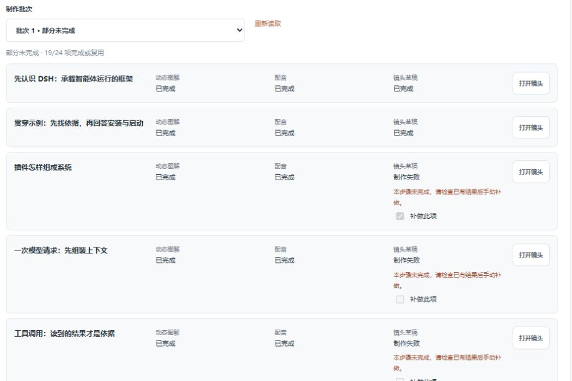
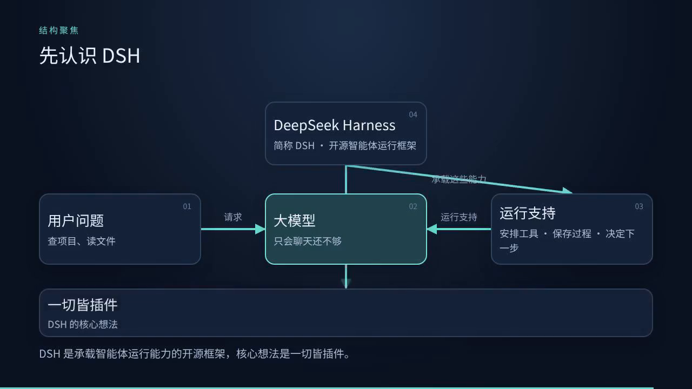

# 视频服务普通用户实测：DSH 架构解析

2026-11-04，北京时间。服务：[video-service.panghuer.top](https://video-service.panghuer.top/)。条目索引见[视频服务记录](README.md)，跟踪见 [Issue #1](https://github.com/zmhhaha/panghu-service-feedback/issues/1)。

**已取得网站原生的完整有声草稿：8 镜头、2 分 54 秒，可下载，站内从0播放至174秒结束，文件全程解码通过。** 首轮8个镜头只有3个草稿成功；简化失败镜头的图解后完成整片。失败原因不具体、无关镜头更新打断编辑，以及连线穿字，是本次最影响使用的问题。正式导出与人工精确校时尚未完成。

[下载原生完整有声草稿 MP4](../../evidence/video-2026-11-04/DSH-architecture-native-draft.mp4)（约 2.82 MB，720p，文稿版本 59）。

## 任务与验证边界

新建独立 DSH 架构解析项目，期望约 3 分钟、8 镜头、16:9、1080p、中文配音和字幕。全部制作与恢复使用正常网页；未修改其他项目，也未用站外合成替代站内视频。

使用者先核对[官方 README](https://github.com/deepseek-ai/deepseek-harness/blob/8bd073392eef6f54e921a093b95076248eb08cbb/README.md)及[架构文档](https://github.com/deepseek-ai/deepseek-harness/blob/8bd073392eef6f54e921a093b95076248eb08cbb/docs/architecture.md)，再输入约 738 字的 8 镜头文稿。核对时仓库最新提交为 `8bd073392eef6f54e921a093b95076248eb08cbb`，默认分支为 `master`。讲稿由使用者准备；服务负责拆分、图解、配音和渲染，不能把本次稿件说成服务自主调研产出。

画面检查包括整片站内从0播放至174秒（播放器状态ended=true）、下载视频的时间抽帧及关键帧核对、整片文件完整解码。音频采用媒体元数据、波形测量和本地ASR辅助核对，8镜头源配音的主要语义均已识别，专名读音及第8镜末字仍有不确定性，不能断言是配音错误。这不等于主观听感验收或专业人工校时，也不据此确认全部缩写发音、精确音画同步。此处说明验证范围，不列为服务问题。

## 制作与恢复

| 时间/阶段 | 实际结果 |
|---|---|
| 09:57:51 | 新建项目，目标 180 秒、8 镜头 |
| 09:58:03—10:00:33 | 拆分约 2 分 30 秒，得到 8 镜头、预计 180 秒，旁白保留 |
| 首次核对制作范围 | 新镜头默认全未选，按钮可点击但误报“连接中断”；勾选后核对成功 |
| 10:01:20 | 提交 8 图解＋8 配音＋8 草稿，共 24 项 |
| 批次 1 完成 | 19/24 项完成：8 图解、8 配音成功；第 1、2、6 镜草稿成功，第 3、4、5、7、8 镜失败 |
| 单项补做 | 仅重试第 3 镜草稿，仍失败，成功内容保留 |
| 10:34 | 第 3 镜简化为图解 2、复用配音 A1，MP4 成功并下载 |
| 后续恢复 | 第 4 镜采用图解 2＋A1，同样成功并下载；其余失败镜头简化为图解 2 |
| 编辑第 7 镜 | 使用者主动精确化旁白；第 4、5 镜图解生成期间发生版本冲突，重新同步后保存成功；旧图解标过期，仅该镜重配音为 A2 |
| 10:48 | 8 镜全部采用后提交整片草稿，页面文稿版本 59 |
| 11:02 | 完整有声草稿成功并下载；174秒，文件全程解码通过 |

最终采用组合：第 1、2、6 镜保留图解 1；第 3、4、5、7、8 镜采用简化后的图解 2。第 7 镜配音采用 A2，其余均保留 A1。第 7 镜文字精确化来自使用者主动修订，不作为服务生成错误。

整片从提交到下载约14分钟，期间主要显示“制作中”，缺少渲染、合成等子阶段进度。创建至首份完整草稿约64分钟（09:57:51—11:02），包含人工检查、返工及等待，不能当成纯服务计算耗时。取得的是草稿；正式导出和人工精确校时仍未完成。

点击“导出MP4”后，页面明确提示“动态时序仍待人工试听核对，完成后才能正式导出。”本次没有生成正式产物。这是明确的导出门槛与验证边界，不列为服务故障；完整有声草稿已取得并可使用。

首轮进度及通用失败提示如下。截图只保留相关批次区域，图中显示前五镜；第 7、8 镜失败也已通过完整进度列表核对。

其他页面证据：[跨镜头版本冲突提示](../../evidence/video-2026-11-04/cross-shot-conflict-public.png) · [空选择操作后的连接中断提示](../../evidence/video-2026-11-04/empty-selection-public.png)。裁图用于保留实际提示文字；操作前提见上表及对应条目，不从提示文字单独推断根因。

## 已取得产物的评价

完整草稿为174秒（2:54）、2,819,035字节，使用H.264＋AAC，1280×720、24fps，音轨为24kHz单声道；全文件FFmpeg解码通过。原始第1镜18秒，第2、6镜各22秒，第3、4镜修订后也取得单镜原生草稿。下载与解码验证通过不等于正式质量验收通过。

8镜顺序正确；7处镜头边界前后约0.15秒抽查均直接切到下一镜标题，未在抽样帧中发现黑屏或错序。这是直接切换，没有据此宣称存在复杂转场或精确音画同步。参见[8镜抽帧总览](../../evidence/video-2026-11-04/full-video-contact-sheet.png)和[整片播放结束截图](../../evidence/video-2026-11-04/full-video-playback-complete.png)。

画面采用深蓝底、白字和青色高亮，主标题与模块标签清楚，未在已检查样本中发现中文乱码。第 6 镜从“一个步骤”到读取说明、补读配置、组织建议，逐步展开的次序有助于解释 step 与 turn。第 2 镜保留了“概念示例、不代表官方仓库实际文件”的输入边界。动态画面确实存在，不是仅停留一张静态完成图。

主要不足在关系表达：第 1 镜 17 秒，DSH 到“一切皆插件”的线穿过“大模型”卡片，视觉上容易误认为从大模型发出；斜线划过“承载这些能力”文字。第 2 镜 21 秒，“再依据文件回答”贴近两端卡片；第 6 镜 21 秒，“没有待处理工作”被斜线穿过。标题清楚不代表关系图已经易读。

完整草稿中的第3镜虽已简化，竖线仍穿过“提供/插件提供”文字。尾卡来源在[173秒帧](../../evidence/video-2026-11-04/full-shot08-173s.png)仍很淡，到[173.75秒帧](../../evidence/video-2026-11-04/full-tail-173.75s.png)才清楚，174秒即结束；只写有`deepseek-ai/deepseek-harness`，缺完整URL与核对日期。来源出现得太晚，难以在正常播放中读完。

[第2镜21秒原生帧](../../evidence/video-2026-11-04/shot02-finalframe.png) · [第6镜21秒原生帧](../../evidence/video-2026-11-04/shot06-finalframe.png)

8段源配音的RMS最大差值约0.454 dB，未检出绝对值≥0.999的满幅采样。整片volumedetect测得平均电平约−28 dB、峰值−9.8 dB。这些是数字电平测量，不是LUFS或主观试听结论，不能单独证明人声自然、发音准确或音量舒适。音频已经存在且完整草稿可下载，不应继续反馈为“网站没有音频”。

当前成片面板明确“不附加字幕”，未见字幕选项；此次路径也未见背景音乐或混音入口。字幕、背景音乐继续作为功能建议，不能当作承诺功能失效。输入要求 1080p 而草稿为 720p，正式规格仍需独立核对。

## 历史条目复测结果

| 条目 | 11月4日结论 |
|---|---|
| VID-001 原生 MP4 | 原生完整有声草稿已下载、解码通过；正式导出未完成 |
| VID-002 版本冲突 | 本次复现；草稿保留，重新同步后能保存，但需额外操作 |
| VID-003 批量与采用 | 24 项制作、单项补做、集中采用已使用；简化后第 3、4 镜恢复；8 镜采用完成 |
| VID-004 进度与诊断 | 逐镜进度改善，失败不丢成功结果；失败诊断不足，整片约14分钟主要显示“制作中” |
| VID-005 规格 | 输入 1080p、已下载草稿 720p，未见清晰规格区分；正式输出待核对 |
| VID-006 版本辨识 | 候选与采用分开；早期单镜产物列表缺镜头名，单镜播放器样本显示“文稿版本 —”，无关更新也提示旧草稿有后续修改；整片播放器明确显示版本59 |
| VID-007 动画 | 单镜动态展开、全片播放及8镜顺序已验证；人工精确同步未完成 |
| VID-008 配音与有声导出 | 逐镜配音、原生WAV、完整有声MP4草稿已验证；正式导出与人工精确校时未完成；可选字幕仍为建议 |
| VID-009 局部更新 | 第 7 镜文稿变更提示旧图解过期，仅该镜配音重生成并采用 A2；其他镜仍为 A1。语速变化和旧任务迟到未覆盖 |
| VID-010 音乐与混音 | 此次路径未见入口，保留功能建议，不推断全站能力 |
| VID-011 空选择错误 | 新增：空选择误报连接中断，成功后旧提示仍保留 |
| VID-012 图解可读性 | 新增：连线穿卡片、穿文字，标签拥挤；尾卡来源清晰停留过短且缺URL与日期 |

## 优先修改及验收条件

| 优先项 | 建议与可执行验收 |
|---|---|
| VID-004 渲染及恢复 | 给出失败镜头、子步骤、可理解原因和脱敏诊断标识，提供针对性补救。用本次5个原始失败方案回归；可成功的直接生成，无法处理的明确定位并提示调整。单项补做不得重做其他图解与配音。整片制作应显示当前阶段、已用时间和完成数，离开再返回仍可辨认进度 |
| VID-002 版本冲突 | 在第 4、5 镜后台生成时编辑第 7 镜，正常保存不应被无关更新阻断；真实同镜冲突应保留草稿、说明差异并支持恢复，迟到结果不覆盖新选择 |
| VID-012 连线避让与尾卡 | 以第1、2、3、6镜检查完成态及动画中间帧；1280×720及640×360显示时，连线不得穿无关卡片或文字，标签不贴边、不出框，箭头起止清楚。尾卡提供完整来源URL和资料核对日期，清晰状态至少保持3～5秒，正常播放能够读完 |
| VID-011 输入提示 | 空选择时禁用核对或提示“请至少选择一个镜头”；补齐后清理旧错误。空选择、单镜、多镜和真实断网应分别给出正确结果 |
| VID-006 产物标识 | 列表和播放器显示镜头序号、名称、图解/配音版本及时间；连续制作8镜后，无需逐一播放就能找到指定版本。仅相关内容变化时提示该草稿过期 |
| VID-005/008 规格与字幕 | 明确显示草稿和正式输出规格，生成前可确认；增加可选字幕或SRT时绑定采用的旁白版本、允许校对并核对时间。保持无字幕输出为明确选项 |

另，第 3 镜自动生成的画面说明含“1920×1080静态SVG”“留足底部字幕空间”，与本项目动态图解、无字幕出口不一致。建议生成说明与当前制作模式使用同一能力口径。

以上反馈保留10月30日历史，并以本次实际观察更新当前状态。完整有声草稿的取得已验证；正式导出、人工精确校时和未覆盖的边界场景不判为通过或失败。
