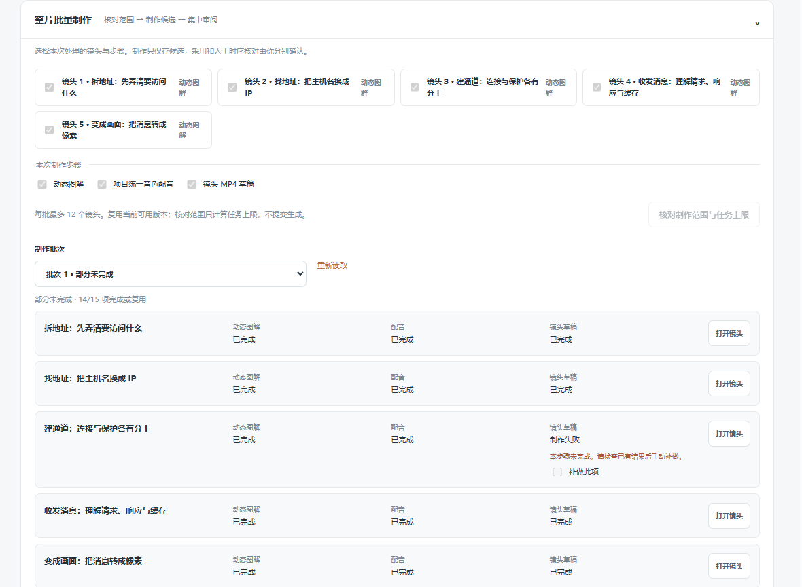
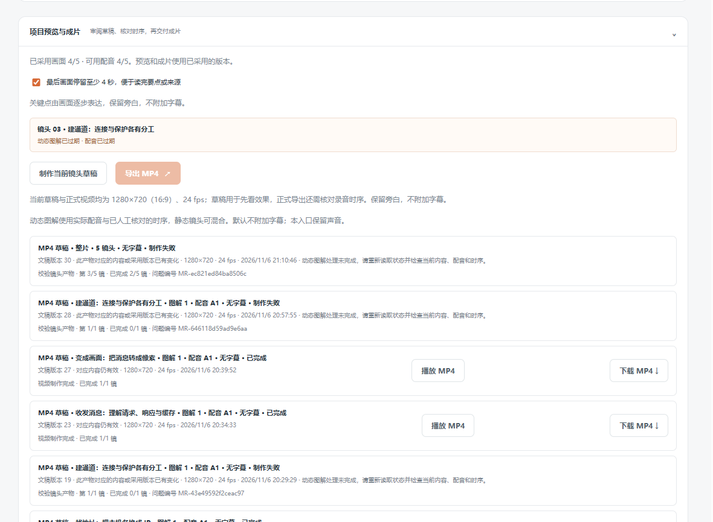
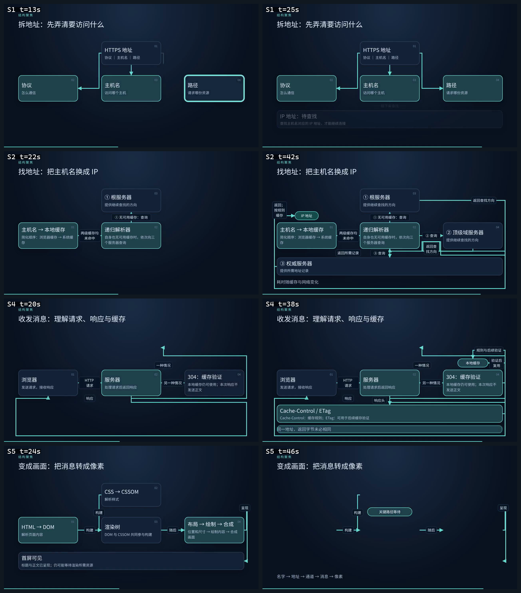
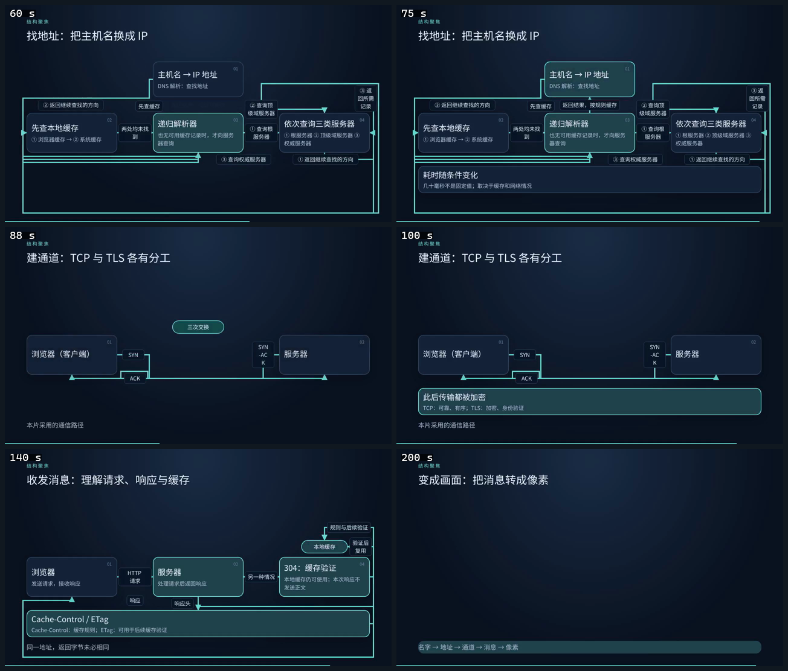

# 视频服务复测：一次 HTTPS 请求的旅程（未取得整片）

2026-11-06（晚），北京时间。服务：[video-service.panghuer.top](https://video-service.panghuer.top/)。[条目索引](README.md) · [跟踪 Issue #1](https://github.com/zmhhaha/panghu-service-feedback/issues/1) · [同日"DSH运行循环"实测](retest-2026-11-06.md)。

> **2026-11-07 更新：服务更新后已重跑，取得整片草稿（204 秒、5 镜），第3镜一次通过。** 详见文末[“服务更新后重跑”](#2026-11-07-服务更新后重跑)；本文其余部分保留 11月6日的原始结果。

**本次换了一个与 DSH 无关的题材，但没有取得整片草稿：5个镜头中4个成功，第3镜的自动图解连续三次校验失败，整片草稿因此在“第 3/5 镜”终止。** 已下载的4段原生单镜MP4合计175秒，720p/24fps，全部解码通过。讲解方案是这次最有价值的部分：它主动纠正了使用者原稿中的技术表述，并逐条说明依据。使用体验的问题集中在状态同步：长任务在后台标签页期间进度不更新，采用方案、采用候选、制作整片三次请求都静默返回409，页面没有任何提示，只有整页刷新后才出现结果。

## 任务与资料

新建项目“一次 HTTPS 请求的旅程｜从地址栏到画面｜2026-11-06”，面向第一次了解网页加载原理的开发者，用五个镜头依次讲拆地址（协议／主机名／路径）、DNS 解析（缓存→递归解析器→根→顶级域→权威）、建立通道（TCP 三次握手与 TLS 证书校验）、收发消息（请求头、200／304、Cache-Control 与 ETag）、渲染（DOM／CSSOM→渲染树→布局→绘制→合成），结尾以“名字→地址→通道→消息→像素”收束。

原稿由使用者准备，服务负责拆分、改写、图解、配音与渲染，因此本片内容不能算网站自主调研。使用者明确要求：这是通用网络原理讲解，不引用具体外部来源，画面只写通用概念名称，不虚构网址、版本号或文献出处。本次未访问或核对任何外部资料，概念正确性依据通用知识判断。

## 制作体验

| 时间 | 阶段 | 实际结果 |
|---|---|---|
| 19:51 | 创建项目 | 5段文稿，视觉方向附加“五镜各讲一步、链路从左到右” |
| 19:53—19:59 | 拆分镜头 | 只显示“正在拆分镜头…”，无子阶段和已用时间；结果5镜、预计175秒 |
| 19:59—20:04 | 首次生成讲解方案 | 约5分半后失败：“讲解生成未完成，现有镜头保持原样，可检查要求后重新提交”，无原因、无失败环节 |
| 20:05—20:13 | 重新提交讲解方案 | 页面持续“制作中”并附“讲解任务暂未完成，可重新读取状态”；“重新读取方案”无变化；点“停止后续任务并申请取消”后立刻显示“已完成”，方案完整。无法判断它何时真正完成 |
| 20:14 | 采用整份方案 | 点击后页面无变化，仍显示“方案1·候选”；网络面板显示接口返回409 revision_conflict；整页刷新后才显示“已采用”，预计时长由175秒变为238秒 |
| 20:16—21:04 | 15项批量制作 | 5图解＋5配音＋5草稿；页面在后台标签页期间停在“制作中”、行内“已等待 1分0秒”不再递增；手动“重新读取”后显示“部分未完成 · 14/15”，第3镜草稿失败 |
| 21:05 | 处理失败项 | 页面提示“项目中还有正在处理的任务”，审阅与补做控件均禁用；点“申请取消”约35秒后该提示消失 |
| 21:05—21:08 | 采用候选 | 勾选5镜后点击“采用所选候选”，页面无确认、选择被清空；整页刷新后确认“已采用画面 5/5 · 可用配音 5/5” |
| 21:10—21:25 | 制作整片草稿 | 首次点击同样静默409；刷新后再点才受理，页面显示“渲染动态画面 · 第 2/5 镜 · 已完成 1/5 镜 · 已等待 3分50秒”；实际在“第 3/5 镜 · 校验镜头产物”失败，问题编号 MR-ec821ed84ba8506c |
| 21:26—21:45 | 尝试修复第3镜 | 单镜草稿重试再次失败（MR-646118d59ad9e6aa）；两次提交“简化图解”要求后，生成的候选与原方案内容完全一致；后来该镜图解生成接口返回 `service_protocol_invalid` / `agent_quarantined`，按钮一直禁用但页面不显示错误 |
| 21:46—22:05 | 缩短第3镜旁白后再试 | 旁白由250字改为121字，旧图解与配音被正确标记“已过期”；新图解生成卡在“提交中”，按钮持续禁用，未得到新候选，因此无法再次制作 |

创建到放弃整片约2小时，其中真正等待约1小时10分钟，其余为失败重试、整页刷新和一次取消。

**失败的具体表现：**第3镜自动图解含8个节点、9条关系（三次握手三条箭头、出示证书、检查证书、协商密钥两条、加密传输，另有“待发送请求”节点带有移动动画）。单镜草稿两次失败，整片在“第 3/5 镜 · 校验镜头产物”第三次失败，页面统一显示“动态图解处理未完成，请重新读取状态并检查当前内容、配音和时序”。编号便于维护者追溯，但对使用者没有指向性：既没说节点过多，也没说该删哪条关系；同镜两次“简化图解”请求也没有改变生成结果。

## 服务使用评价

**做得好：**

- **讲解方案的技术审校**。方案没有照抄原稿，而是把“200表示有新内容”改为“200表示请求成功，但不表示内容一定比本地更新”；把“DNS通常几十毫秒”限定为随缓存与网络变化并说明数字来自原稿；把“任何一环慢都会多白屏”限定为关键路径上的等待；把 TCP“不丢不乱”改为“可靠、有序”。每条都写在“需要人工核对”里，使用者可以直接判断是否接受。这是本次质量提升的主要来源。
- **规格口径一致**。方案的画面说明这次写的是1280×720，与输出面板“草稿与正式均为1280×720、24fps、不附加字幕”一致；[VID-005](README.md#vid-005)中“方案写1080p”的现象本次未复现。
- **单镜产物可追溯**。每段草稿卡片都有镜头名、图解版本、配音版本、文稿版本、时间和 1280×720/24fps；修改旁白后，旧图解与配音被正确标记“已过期”，没有悄悄沿用。
- **整片渲染的进度字段**。页面在前台时，整片草稿能看到当前镜号、已完成数、子阶段（渲染/校验）和等待时间，比批次行清楚。

**需要改：**

- **写操作静默失败（[VID-013](README.md#vid-013)）**。采用方案、采用候选、制作整片三次点击都没有任何可见反应，实际是409 `revision_conflict`；页面不提示冲突、不提供重试入口，只有整页刷新才恢复。普通用户会认为按钮坏了或反复点击。
- **后台标签页的状态不追赶（[VID-014](README.md#vid-014)）**。批次在后台标签页运行时，行状态与等待时间都不更新；切回页面也不会自动追上真实结果，需要“重新读取”或整页刷新。对“启动批次后去干别的事”的常见用法影响明显。
- **图解密度与失败提示（[VID-015](README.md#vid-015)）**。有诊断编号是进步，但应指出具体图元与可执行动作；“简化要求”对生成无效时，用户没有别的路径，只能自己改写旁白或拆镜。
- **时长口径（[VID-005](README.md#vid-005)）**。采用方案后总时长从175秒变为238秒（+36%），采用前没有目标时长设置或增量提醒，只能事后发现。
- **结尾帧与标签排版（[VID-012](README.md#vid-012)）**。见下文产物评价，已下载的四段里结尾空帧、标签断词、文字贴容器边缘都能直接看到。

## 产物评价（已下载的4段单镜草稿）

| 文件检查 | 结果 |
|---|---|
| 交付形态 | 未取得整片；4段原生单镜MP4（第3镜失败） |
| 时长合计 | 175秒（29、49、44、53） |
| 视频 | 四段均为 H.264、1280×720、24fps |
| 声音 | AAC、24kHz、单声道；平均数字电平 −27.6～−28.0dB，峰值 −10.7～−11.3dB |
| 完整性 | 四段 FFmpeg 全文件解码无错误 |
| 未验证 | 整片连贯性、正式导出、主观试听、人工精确校时 |

四段画面如下（每镜取45%与85%两个时刻，未改字、未重绘）：

**内容层：**去掉第3镜后，现有四段仍能连成“拆地址→找地址→收发消息→变成画面”的链条。术语准确（协议/主机名/路径、缓存未命中、递归解析器、200与304的区别、DOM/CSSOM与渲染树），方案对 200 的修正也体现在配音里。第1镜“拆地址”与第4镜“收发消息”开头一段的节点少、层级清楚，是最容易看懂的两处。

**画面层：**主要问题仍是“能读到字，但关系要靠猜”，且这次新增两类明显缺陷：

- **第2镜（找地址）后段拥挤**：42秒帧里，“③ 权威服务器”卡片横贯画面底部，与左侧“主机名→本地缓存”卡片几乎相接；标签“返回；按规则缓存”被压成竖排三行，“返回查／找方向”在窄框内断成两行，“两级缓存均未命中”同样换行；三条查询箭头在“递归解析器”下方汇聚成同一个箭头，指向对象不明确。[原尺寸帧](../../evidence/video-2026-11-06-https/shot02-overlap-42s.png)
- **第4镜（收发消息）容器与裁切**：38秒帧底部有两个无标题的圆角容器套住“Cache-Control / ETag”，其中“同一地址，返回字节未必相同”紧贴容器下沿；“304：缓存验证”卡片右端几乎贴到画面边缘，副标题“本次响应不发送正文”在卡片内折行后空间很紧；右上“本地缓存”卡片外的“验证后复用”也被容器边界压住。[原尺寸帧](../../evidence/video-2026-11-06-https/shot04-clipping-38s.png)
- **第5镜（变成画面）结尾空帧**：52.6秒只剩四条箭头和“构建／随后／呈现”几个标签，所有节点都已消失，回顾链“名字→地址→通道→消息→像素”孤立在底部；末镜按“最后画面停留至少4秒”保留的正是这张几乎空白的画面。[原尺寸帧](../../evidence/video-2026-11-06-https/shot05-empty-end-52s.png)
- **第1镜（拆地址）**：三张卡片与水平/垂直箭头清楚，未发现连线穿越正文或断词。

音频按未压缩的媒体元数据与数字电平检查，四段一致性好；本次没有做主观试听、语音自然度或音画同步验收。

## 历史条目复测

| 条目 | 11月6日晚结论 |
|---|---|
| VID-001 原生MP4 | 4段单镜原生有声草稿可下载、解码通过；整片未取得 |
| VID-002 版本冲突 | 单镜编辑未冲突；采用与渲染请求返回409，见VID-013 |
| VID-003 批量与采用 | 15项中14项完成；失败项补做再次失败；简化要求对生成无效 |
| VID-004 进度与诊断 | 失败信息有编号但仍笼统；整片进度字段在前台可见，后台不更新 |
| VID-005 规格与估时 | 方案已写1280×720，与面板一致；采用后总时长175→238秒，无提醒 |
| VID-006 版本辨识 | 单镜卡片含图解/配音/文稿版本与时间，改旁白后正确标“已过期” |
| VID-007 动态图解 | 四段中可见节点逐步出现；整片未取得，连续动画未验证 |
| VID-008 配音与有声输出 | 4段原生有声MP4、AAC 24kHz；主观试听与精确校时未做 |
| VID-009 局部更新 | 改旁白后该镜图解与配音标“已过期”符合预期；未覆盖换声与语速 |
| VID-010 音乐与混音 | 本次路径未见入口，保留功能建议 |
| VID-011 空选择误报 | 本次未复现，未复测 |
| VID-012 图解与尾卡 | 第2镜节点贴合与断词、第4镜容器裁切、第5镜结尾空帧，见产物评价 |
| VID-013 静默409 | 采用方案、采用候选、制作整片三次复现 |
| VID-014 后台状态 | 批次与整片在后台标签页期间不更新，需手动读取 |
| VID-015 图解密度 | 第3镜8节点9关系，单镜两次、整片一次校验失败；简化请求无效 |

## 优先建议与验收条件

| 建议 | 可执行验收 |
|---|---|
| 图解生成遵守渲染预算（VID-015） | 用本次第3镜原方案回归：生成前按节点数、关系数、标签长度检查，超限先自动简化或建议拆镜；不得出现“生成成功、渲染必败”的方案 |
| 失败提示指向具体图元（VID-015） | 把 `motion_invisible_move` 等诊断码映射成中文动作（哪个图元、什么动画、建议怎么改），并高亮该图元；提供一键简化候选 |
| 写操作自动恢复（VID-013） | 409 时自动重取版本并重试一次；仍失败则显示“项目已更新，请重新载入”，保留用户已勾选范围；成功时立即更新按钮与候选状态 |
| 后台标签页状态追赶（VID-014） | 切回页面立刻刷新任务状态；等待时间按真实时间递增；终态出现后清除“停止后续任务并申请取消”入口。验收：切到后台等长任务结束，30秒内自动显示真实终态 |
| 时长目标与增量（VID-005） | 采用方案前显示各镜与原稿的时长差异和总增量；可设目标时长并在超限时提示精简 |
| 结尾帧保底（VID-012） | 任一镜头结束时不得只剩箭头或空容器；若节点需要隐藏，应保留收束链或结构框；末镜4秒停留的内容应可读 |
| 标签与容器排版（VID-012） | 标签不自行拆词换行；文字与容器内边距按最长行计算，卡片不贴画面边缘；验收第2、4镜原方案在720p与640×360下均无断词、无压边 |

## 边界说明

本次所有操作通过正常网页完成，未修改服务代码、未进入服务器。没有取得整片，因此“整片连贯性、正式导出、人工精确校时”均未验证；没有使用字幕与背景音乐。第3镜失败后开发者曾缩短旁白再试，属于使用者规避性返工，不代表内容需要改写才能成立。公开附件只保留原生单镜产物、抽帧与必要页面裁图，不含账户信息和完整会话记录。

## 2026-11-07 服务更新后重跑

2026-11-07 01:00—01:30（北京时间），在同一个项目、同一份内容上重跑：第3镜重新生成图解、重新配音，第2镜重新生成图解，然后重制整片。**结果：整片草稿成功，204 秒、5 镜、1280×720/24fps、AAC 24kHz 单声道，全文件解码通过。**

[下载原生整片草稿](../../evidence/video-2026-11-07/https-journey-native-draft-v2.mp4)（约3.44MB，文稿版本46）。

| 阶段 | 本次结果 |
|---|---|
| 第3镜重新生成图解 | 约1分半得到新候选；节点8→7、关系9→7，**去掉了“移动”动画**，只用出现与连线展开 |
| 第3镜单镜草稿 | 首次即通过，实际25秒（旧图解三次失败） |
| 第3镜重新配音 | 约20秒完成A2，采用后与当前旁白匹配 |
| 第2镜重新生成图解 | 约1分半；三类服务器由三个节点合并为一个“依次查询三类服务器”节点 |
| 整片草稿 | 提交到完成约13分钟，第1/5→5/5 逐镜推进，合成完成，无失败 |

**画面上的实际变化：**

- **第3镜（88—110秒）明显变清楚**：浏览器与服务器两端、一条水平线上的三次握手（SYN／SYN-ACK／ACK）、底部“此后传输都被加密”结论条，一眼能读懂顺序。这是本次最直观的改进。[原尺寸帧](../../evidence/video-2026-11-07/shot03-clean-handshake-100s.png)
- **第2镜（32—84秒）结构变简单、排版仍挤**：三个服务器盒合并成一个，理论上少了四条连线；但标签仍与卡片重叠（“② 返回继续查找的方向”压在“先查本地缓存”上，“② 查询顶级域服务器”贴住递归解析器右缘，“③ 返回所需记录”贴右边界），底部还有空容器。[原尺寸帧](../../evidence/video-2026-11-07/shot02-grouped-servers-75s.png)
- **第4镜、第5镜未变**：第4镜仍有空容器与贴边文字；第5镜末尾仍是几乎空白的画面，只剩“关键路径等待”和一个箭头。[第5镜末帧](../../evidence/video-2026-11-07/shot05-empty-end-200s.png)

**对既有条目的影响：**

| 条目 | 更新 |
|---|---|
| [VID-001](README.md#vid-001) | 本次取得原生整片有声草稿（204秒），此前“整片未取得”只代表11月6日状态 |
| [VID-015](README.md#vid-015) | 部分改善：生成更克制（关系9→7、无移动动画），第3镜一次通过；第2镜即使合并节点，标签重叠仍未解决 |
| [VID-012](README.md#vid-012) | 第3镜的“一条线三个节拍＋结论条”是可行范式；第2、4、5镜的排版问题仍在 |
| [VID-013](README.md#vid-013)、[VID-014](README.md#vid-014) | 本次页面保持前台、版本为最新，未复现静默409与状态停滞；这两条仍需专门复测 |

**仍未验证：**整片连贯性的主观评价、逐镜音画同步、正式导出（“导出 MP4”仍要求人工时序确认）、字幕与背景音乐。第2镜生成的图解虽然结构更简，但排版仍未达到“缩到640×360也清楚”的标准。
