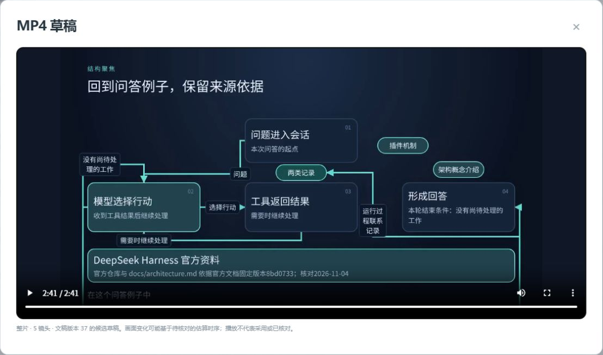
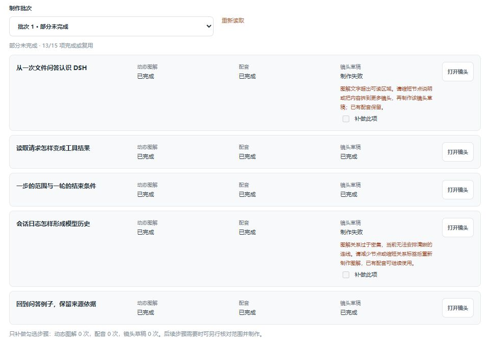
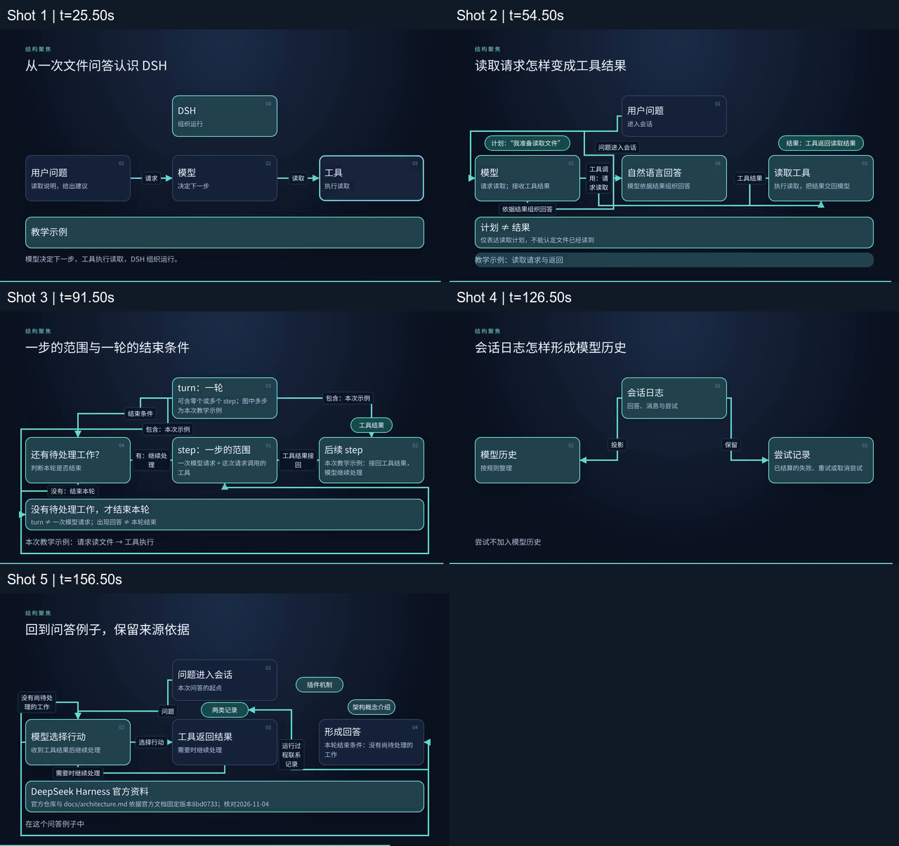

# 视频服务普通用户复测：DSH 运行循环

2026-11-06，北京时间。服务：[video-service.panghuer.top](https://video-service.panghuer.top/)。[条目索引](README.md) · [跟踪 Issue #1](https://github.com/zmhhaha/panghu-service-feedback/issues/1) · [11月4日历史实测](retest-2026-11-04.md)。

**已完成一次新制作，取得网站原生完整有声草稿：5镜头、2分41秒、720p/24fps。** 下载、站内从0播放至161秒结束、全文件解码均通过。讲解方案、具体失败诊断、阶段进度、版本标识和空选择提示已有改善；自动图解仍需返工，跨镜版本冲突、流程与层级表达、来源网址保留仍需优化。交付为草稿；正式导出、主观试听及人工精确校时未完成。

[下载原生MP4草稿](../../evidence/video-2026-11-06/DSH-runtime-cycle-native-draft.mp4)（约2.88MB，文稿版本37）。

## 任务与资料

新建“DSH运行循环｜从文件问答到两类记录｜2026-11-06”，面向初次了解Agent框架的开发者，用读文件问答串起模型、工具、step/turn和两类记录，目标约2分钟、5镜头、中文配音。项目明确要求教学例子不代表真实仓库文件，来源完整网址与版本日期至少清楚展示5秒。

使用者准备初稿，并重新阅读[官方固定版本架构文档](https://github.com/deepseek-ai/deepseek-harness/blob/8bd073392eef6f54e921a093b95076248eb08cbb/docs/architecture.md)，通过“这次额外调整”要求精确化：step包括一次模型请求及所调用的工具；turn可含零个或多个step，以没有尚待处理工作为结束条件；模型历史从日志按规则投影，已结算的尝试记录不加入。原稿的过度简化来自使用者，不作为服务生成错误。

服务负责拆分、讲解方案改写、动态图解、配音与渲染。方案明确说明未访问官方资料，其来源摘录只是追溯原稿；不能将本次制作说成服务自主调研或主动查证。画面“核对2026-11-04”沿用输入中的记录，不代表服务自动核查到11月6日。

## 制作体验

| 阶段 | 实际结果 |
|---|---|
| 17:51:48创建，17:52:14提交拆分 | 最多5镜，约17:54得到5镜、预计125秒，原旁白保留 |
| 17:54:59—17:58:55 | 生成讲解方案，约4分钟；逐镜比较新旧内容，预计合计120秒；明确审阅采用后才更新镜头 |
| 17:59:44启动首批 | 5图解＋5配音＋5单镜草稿，共15项；约18:17确认13/15成功，仅第1、4镜草稿失败 |
| 局部恢复 | 第1镜文字超区，第4镜关系过密；简化画面说明、重做图解2，五段原配音A1均保留。第1镜单镜草稿恢复成功，第4镜随后在整片中验证恢复 |
| 跨镜操作 | 第1镜后台生成期间处理第4镜，顶部出现项目更新冲突；第4镜画面说明已保存，生成未启动，重新读取后提交成功 |
| 18:25:30—18:36:29 | 提交版本37整片，约11分钟后确认完成；显示当前镜号、已完成数量、渲染/整理/校验阶段及等待时间 |
| 下载与播放 | 18:36取得原生整片，随后站内从0连续播放到161秒，播放器ended=true；本地全文件解码通过 |

创建到取得完整草稿约45分钟，包含方案审阅、返工、等待和检查，不是纯模型或渲染耗时；本轮5镜与上轮8镜不能据此直接比较性能。

讲解方案用一个贯穿例子串起概念，保留教学边界，并将补充的术语定义准确写入候选，实际有帮助。它同时列出来源和待核对事项，能让使用者判断依据。不过，方案预计120秒，实际五段配音为26、29、37、35、30秒，共157秒，视频另加4秒尾部；目标、估计、录音和最终时长应更清楚地区分。

失败说明比上轮具体：第1镜提示“图解文字超出可读区域”，建议缩短节点或拆镜；第4镜提示“图解关系过于密集，当前无法安排清晰的连线”，建议减少节点或缩短关系标签。两者都说明已有配音保留，其他镜头继续执行。**但由服务自动生成的5个图解中，仍有2个不能直接渲染，需要使用者理解限制、手工缩减。**

批次运行中可以打开编辑表单并输入修改，但保存按钮禁用，表单未解释解锁条件；取消编辑后草稿仍保留，刷新亦能恢复。保护草稿有用，按钮含义和下一步应更清楚。跨镜冲突也再次出现，[顶部提示截图](../../evidence/video-2026-11-06/cross-shot-conflict-public.png)只证明提示，具体前提见上表，不能单凭图片定位后台根因。

输出面板现在明确草稿和正式均为720p、24fps、不附加字幕；单镜列表和播放器也显示镜头名、图解/配音/文稿版本、生成时间及内容有效性，见[页面证据](../../evidence/video-2026-11-06/output-specifications-public.png)。不过，拆分及讲解方案的画面说明仍写“正式1920×1080”，与面板能力口径不一致。

## 产物评价

最终组合：第1、4镜图解2，其余图解1，全部A1配音；整片文稿版本37，未站外重合成。

| 文件检查 | 结果 |
|---|---|
| 时长与大小 | 161.000秒，2,880,071字节 |
| 视频 | H.264、1280×720、24fps |
| 声音 | AAC、24kHz、单声道；平均数字电平约−27.9dB，峰值约−10.4dB |
| 完整性 | FFmpeg全文件解码无错误；站内连续播放到结束 |
| SHA256 | `d21f45d6fd4fe3261c9f45143a2404918b4877a4fc8693122935cc2ce94f873e` |

讲稿的顺序连贯，保留了教学例子和关键定义。视频的深蓝底、白字、青色强调一致，主标题与主要节点清楚，已检查样本未见中文乱码。第1、4镜简化后的短文字和少量关系明显更清爽。五镜代表帧如下，画内文字未修改：

主要问题仍是“能看清字，未必能一眼看懂关系”：

- **第2镜**：整片54.5秒代表帧中，节点按01上、02左、03右、04中摆放，请求、返回与回答连线折返。“工具调用：请求读取”挤成多行，夹在模型与回答之间，需要追线才能确认连接对象。“计划≠结果”的主结论本身清楚。
- **第3镜**：91.5秒帧中，step/turn文字定义准确，但用同级卡片加“包含”连线表达层级，没有落实方案中的turn外框包step、step内含请求与工具。底部矩形回线也像没有标题的容器。
- **第5镜**：129秒来源已可见；156—160.938秒的8个末尾样本均清楚，固定版本和日期保留，比上轮最后不足一秒才清楚明显改善。要求的完整官方URL却在图解阶段丢失，只剩仓库名和文档路径。结束判断连向“形成回答”卡片，也可与独立的“本轮结束”区分得更清楚。

4处镜头边界26、55、92、127秒前后各0.15秒抽样，均从前镜完成图直接切到后镜标题，8帧中未见黑屏或错序。末镜保留4秒静音阅读时间；[末5秒抽样](../../evidence/video-2026-11-06/final-5s-contact-sheet.png)能看到来源持续清楚。这是抽样和播放检查，不等于逐帧认证、复杂转场或人工精确同步验收。

5段源WAV平均数字电平最大差约0.3dB；整片在0/26/55/92/127秒的对应主体波形与源录音相关性均超过0.99994，最佳匹配位移均为0ms。比较排除了每段首尾各0.15秒，支持采用录音的主体、顺序和名义起点一致，不能据此确认末字完整、专名发音、语气自然或画面与旁白精确同步。157秒后的4秒尾部为静音。数字电平不是LUFS或主观舒适度评价；本次未作ASR或主观试听通过声明。

点击正式“导出MP4”后，页面仍提示“动态时序仍待人工试听核对，完成后才能正式导出”。本次没有虚假勾选人工确认，交付为完整草稿；该明确门槛不作为服务故障。当前入口明确不附加字幕，字幕仍属功能建议；本轮未使用背景音乐或混音，不推断全站缺少相关能力。

## 历史条目复测

| 条目 | 11月6日结论 |
|---|---|
| VID-001 原生MP4 | 161秒原生完整有声草稿下载、播放和解码通过；正式导出未完成 |
| VID-002 版本冲突 | 跨镜后台更新时实际复现；草稿保留、重新读取后恢复 |
| VID-003 批量与采用 | 15项批量与集中采用已使用；第1、4镜简化后恢复，成功项与原配音保留 |
| VID-004 进度与诊断 | 具体失败原因、恢复建议、镜号、子阶段、完成数和等待时间改善；自动图解仍有2/5草稿需返工 |
| VID-005 规格与估时 | 面板明确均为720p，生成说明仍写正式1080p；方案120秒、实际配音157秒，视频161秒 |
| VID-006 版本辨识 | 单镜及整片标识清楚；第1镜相关变化标旧，第2/3/5镜无关更新后仍有效；迟到结果未覆盖 |
| VID-007 动态图解 | 整片动态展开、顺序、播放及边界抽样通过；层级和复杂走线待优化，人工精确同步未完成 |
| VID-008 配音与有声输出 | 5段原生WAV、完整有声草稿与主体波形对应已验证；主观试听、人工校时、正式导出未完成 |
| VID-009 局部更新 | 第1、4镜只改画面、复用A1；换声、语速变化、旧任务迟到未覆盖 |
| VID-010 音乐与混音 | 本路径未使用，保留功能建议，不作全站能力判断 |
| VID-011 空选择误报 | 本场景通过：明确提示至少选一镜并禁用按钮；真实断网、旧错误清理未覆盖 |
| VID-012 图解与尾卡 | 末尾来源阅读时间、版本日期改善；完整URL仍缺，复杂走线、标签与层级表达待优化 |

## 优先建议与验收条件

| 建议 | 可执行验收 |
|---|---|
| 让自动图解遵守渲染限制（VID-004/012） | 用本次5个原方案回归，在生成阶段检查文本空间与关系密度；能处理的直接出草稿，不能处理的先简化或建议拆镜。保留成功项与配音，不要求重做整个项目 |
| 按含义安排图形（VID-012） | 第2镜用明确顺序与独立请求/返回路径；第3镜用嵌套框表达层级。720p及640×360下标签可读、箭头对象无歧义；完整来源URL、版本、日期至少清楚停留5秒，检查方案到图解的要求保留 |
| 减少跨镜冲突，解释编辑限制（VID-002/003） | 第1镜后台生成时可正常处理第4镜无关修改；真实同镜冲突保留差异和草稿。若批次必须锁定编辑，应在输入前说明原因与解锁条件，明确“取消”是否保留草稿 |
| 统一规格和估时（VID-005） | 生成说明使用真实720p能力；区分目标、估计、实际录音与最终时长。配音完成后及时更新总时长，超目标时提供精简或配速选择 |

本次所有制作与恢复通过正常网页，未修改服务代码或进入服务器，未取消在线制作任务。公开附件只保留原生产物与必要页面、抽帧证据；完整会话、账户信息和原始内部工作资料不发布。未覆盖的边界保留未验证，不因本次成功关闭全部历史问题。
